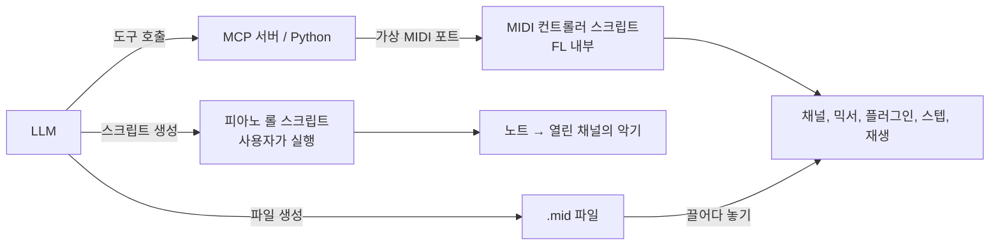

# FL Studio 스크립팅과 LLM 연동 분석

> 대상: FL Studio 2024\~2025 버전 기준
> 목적: Score 파일(.fsc)의 형식, FL Studio의 Python 스크립팅이 제어할 수 있는 범위, 그리고 LLM이 도구를 써서 악보를 만들고 FL Studio를 조작할 수 있는 방법을 정리한다.
> 표기: `[공개 정보]` 공식 문서나 널리 알려진 공개 정보 (작성 시점 기준이며, 공식 문서와 하나하나 대조하지는 않았음) / `[추정]` 공개 자료와 동작 관찰을 바탕으로 한 추정 / `[미확인]` 기억에 의존한 내용으로, 공식 문서 대조가 필요함
> 관련 문서: [주요 시스템 분석](FL_Studio_주요시스템분석.md) · [작곡 파이프라인별 기능 활용 분석](FL_Studio_작곡파이프라인_활용분석.md) · [문서 색인](README.md)
> 고지: 이 문서는 FL Studio를 배우기 위한 **비공식 학습 자료**이며 Image-Line과 관련이 없습니다. FL Studio, FL Cloud와 FLEX, Sytrus, Harmor, Gross Beat 등 제품과 플러그인 이름은 Image-Line의 상표입니다. 내용은 공개 자료와 사용자가 볼 수 있는 동작을 바탕으로 한 학습자의 해석이며, 소프트웨어를 디컴파일하거나 분해해서 얻은 정보는 없습니다.

---

## 목차
1. [Score 파일 (.fsc) 형식](#1-score-파일-fsc-형식)
2. [두 가지 Python 스크립팅 환경](#2-두-가지-python-스크립팅-환경)
3. [피아노 롤 스크립트의 제어 범위](#3-피아노-롤-스크립트의-제어-범위)
4. [MIDI 컨트롤러 스크립트의 제어 범위](#4-midi-컨트롤러-스크립트의-제어-범위)
5. [기본 악기와의 연결 문제](#5-기본-악기와의-연결-문제)
6. [LLM이 악보를 만드는 네 가지 방법](#6-llm이-악보를-만드는-네-가지-방법)
7. [LLM - FL Studio 연동 구조 설계](#7-llm---fl-studio-연동-구조-설계)
8. [스크립팅 시스템의 기획 의도](#8-스크립팅-시스템의-기획-의도)
9. [검증이 필요한 항목](#9-검증이-필요한-항목)

---

## 1. Score 파일 (.fsc) 형식

### 1.1 요약
.fsc는 **프로젝트 파일(.flp)과 같은 이벤트 형식에서 노트 관련 이벤트만 남긴 축소판**일 가능성이 높다 `[추정]`.
- 악기 정보 없이 **노트와 FL 전용 노트 속성**만 담는다.
- 피아노 롤의 Save score as / Load score로 저장하고 불러온다 `[공개 정보]`.
- 분석 당시 작업 PC에 FL Studio가 설치되어 있지 않아 실제 파일로 확인하지 못했다. 아래 구조는 공개된 .flp 분석 자료(PyFLP 등)를 근거로 한 것이다.

### 1.2 파일 껍데기
.flp와 같은 청크 구조로 보인다 `[추정]`.
```
"FLhd" | 헤더 크기(4B) | format(2B) | 채널 수(2B) | PPQ(2B)
"FLdt" | 데이터 크기(4B) | 이벤트 스트림 ...
```
이벤트는 ID 범위에 따라 값의 크기가 정해진다 (시스템 분석 12.2절).

| 이벤트 ID | 값 크기 |
|---|---|
| 0 \~ 63 | 1 byte |
| 64 \~ 127 | 2 byte |
| 128 \~ 191 | 4 byte |
| 192 \~ 255 | 가변 길이 (7bit varint 길이 + 데이터) |

### 1.3 노트 배열
- 핵심은 ID 192 이상의 **가변 길이 노트 이벤트 하나**이다.
- 그 안에 노트 하나당 **24바이트 고정 크기 구조체**가 이어져 있다 `[추정]`.

| 오프셋 | 크기 | 필드 | 설명 |
|---|---|---|---|
| 0 | 4 | position | 시작 위치 (tick) |
| 4 | 2 | flags | Slide 등 플래그 |
| 6 | 2 | rack channel | 채널 번호 |
| 8 | 4 | length | 길이 (tick) |
| 12 | 2 | key | MIDI 노트 번호 |
| 14 | 2 | group | 노트 그룹 |
| 16 | 1 | fine pitch | 미세 음높이 |
| 17 | 1 | (미확인) | |
| 18 | 1 | release | 릴리스 세기 |
| 19 | 1 | MIDI 채널 | 노트 색상과 같은 값 |
| 20 | 1 | pan | |
| 21 | 1 | velocity | |
| 22 | 1 | mod X | |
| 23 | 1 | mod Y | |

### 1.4 해석
- 위 구조는 공개된 커뮤니티 문서를 옮긴 것이며 **공식 명세가 아니다.** 버전이 바뀌면 달라질 수 있다.
- **이 프로젝트는 .fsc나 .flp를 직접 만들거나 바이너리를 분석하는 방법을 권하지 않는다.** Image-Line 이용 약관은 소프트웨어의 리버스 엔지니어링, 디컴파일, 분해를 금지하므로, Score 파일이 필요하면 공식 경로(피아노 롤 스크립트로 노트를 만든 뒤 Save score as, 또는 MIDI 가져오기)를 쓴다.

---

## 2. 두 가지 Python 스크립팅 환경

FL Studio에는 성격이 전혀 다른 Python 스크립팅이 두 가지 있다 `[공개 정보]`.

| 구분 | 피아노 롤 스크립트 | MIDI 컨트롤러 스크립트 |
|---|---|---|
| 모듈 | `flpianoroll` | `transport`, `channels`, `mixer`, `plugins`, `patterns`, `playlist`, `arrangement`, `ui`, `general`, `device` 등 |
| 원래 용도 | 노트를 만들고 바꾸는 사용자 도구 | 하드웨어 MIDI 컨트롤러 연동 |
| 실행 방식 | 피아노 롤 Tools > Scripting에서 **사용자가 한 번 실행** | FL이 켜져 있는 동안 **계속 실행**, MIDI 메시지가 오면 반응 |
| 제어 대상 | 지금 열린 피아노 롤의 노트 | 프로젝트 전체 (이미 있는 대상 위주) |
| 외부와 통신 | 불가 | MIDI 포트로 메시지를 받는다 |
| LLM 연동 관점 | 노트 생성 담당 | 실시간 조작 담당 |

---

## 3. 피아노 롤 스크립트의 제어 범위

### 3.1 가능한 것
- **노트 추가, 수정, 삭제**. 다룰 수 있는 속성은 음높이, 위치, 길이, 세기, 팬, 릴리스, 색상, Mod X/Y, 미세 음높이, Slide, Porta, 뮤트 `[미확인]`
- **마커 추가**, PPQ와 박자 정보 읽기 `[미확인]`
- 실행할 때 **입력 창**(슬라이더, 선택 상자 등)을 띄워 사용자에게 값을 받기 `[공개 정보]`

### 3.2 불가능한 것
- 다른 채널이나 다른 패턴의 노트
- 악기 선택이나 불러오기
- 믹서, 플레이리스트, 프로젝트 저장

### 3.3 예시: 코드 진행 생성
```python
import flpianoroll as flp

# Am - F - C - G, 마디당 코드 하나
chords = [[57, 60, 64], [53, 57, 60], [48, 52, 55], [55, 59, 62]]
bar = flp.score.PPQ * 4

for i, chord in enumerate(chords):
    for key in chord:
        n = flp.Note()
        n.number = key
        n.time = i * bar
        n.length = bar
        n.velocity = 0.8
        flp.score.addNote(n)
```
- 함수와 속성 이름은 `[미확인]`이다. 공식 API 문서로 확인한 뒤 사용한다.
- 결과를 Save score로 저장하면 .fsc가 된다. 즉 **.fsc를 직접 만들지 않고도 공식 경로로 .fsc를 얻을 수 있다.**

---

## 4. MIDI 컨트롤러 스크립트의 제어 범위

### 4.1 모듈별 가능한 것 `[미확인]`
| 모듈 | 가능한 것 (예) |
|---|---|
| `transport` | 재생, 정지, 녹음, 템포, 재생 위치, PAT/SONG 모드 전환 |
| `channels` | 채널 선택, 볼륨·팬·뮤트, **믹서 연결 대상 지정**, **스텝 시퀀서 스텝 켜고 끄기**, 노트 실시간 연주 |
| `mixer` | 트랙 볼륨·팬·뮤트·이름·색상, **트랙 간 라우팅** |
| `plugins` | 이미 불러온 악기·이펙트의 **파라미터 읽고 쓰기** (예: FLEX의 필터 컷오프) |
| `patterns` | 패턴 이동, 이름, 색상 |
| `playlist` / `arrangement` | 트랙 이름, 색상, 뮤트, 마커 |
| `ui` / `general` | 창 전환, 되돌리기 등 |

### 4.2 불가능한 것 (알려진 범위)
- 새 채널 만들기, 플러그인이나 샘플 불러오기
- 믹서 슬롯에 이펙트 넣기
- 피아노 롤에 노트 직접 쓰기 (스텝 시퀀서의 스텝은 쓸 수 있음)
- 플레이리스트에 패턴 클립 배치하기

### 4.3 해석
MIDI 스크립트는 **"이미 만들어진 프로젝트를 손으로 만지는 것"을 대신하는 API**이다. 하드웨어 컨트롤러가 노브를 돌리고 버튼을 누르는 범위와 거의 같다. 새 요소를 만드는 일(악기 불러오기, 클립 배치)은 범위 밖이다.

---

## 5. 기본 악기와의 연결 문제

**질문:** 스크립트로 만든 악보를 기본 악기(FLEX, 3x Osc 등)에 연결할 수 있는가?

**답:** **이미 프로젝트에 있는 악기라면 가능하다. 새 악기를 불러오는 것은 불가능하다.**

| 하려는 일 | 가능 여부 | 방법 |
|---|---|---|
| 악기에 노트 넣기 | 가능 | 그 악기 채널의 피아노 롤을 열고 피아노 롤 스크립트 실행 |
| 드럼 스텝 찍기 | 가능 | MIDI 스크립트로 스텝 켜기 |
| 악기 소리 조절 | 가능 | MIDI 스크립트로 플러그인 파라미터 변경 |
| 악기를 믹서 트랙에 연결 | 가능 | MIDI 스크립트로 채널의 믹서 대상 지정 |
| 실시간으로 악기 연주 | 가능 | MIDI 스크립트로 노트 연주 |
| 새 악기 불러오기 | 불가능 | 사용자가 직접 추가하거나 템플릿 사용 |

**우회 방법: 템플릿 프로젝트**
- FLEX, 3x Osc, 드럼 키트, 808 등을 미리 불러와 둔 템플릿에서 시작한다.
- 채널 이름과 순서를 고정해 두면 LLM은 "어떤 채널을 쓸지 고르고 조절하는" 역할만 하면 된다.
- 예: 채널 0 Kick, 1 Snare, 2 Hat, 3 808, 4 Pad(FLEX), 5 Lead(3x Osc).

---

## 6. LLM이 악보를 만드는 네 가지 방법

| 방법 | 흐름 | FL 전용 속성 | 안정성 | 비고 |
|---|---|---|---|---|
| **1. 피아노 롤 스크립트 (추천)** | LLM이 Python 스크립트 작성 → 사용자가 피아노 롤에서 실행 | 모두 사용 가능 | 높음 | 공식 API. 결과를 .fsc로 저장 가능 |
| **2. MIDI 파일 생성** | LLM이 Python(`mido` 등)으로 .mid 생성 → FL로 끌어다 놓기 | 손실 (시스템 분석 13.3절) | 매우 높음 | 다른 DAW, 악보 프로그램과도 호환. 오선 악보로 이어짐 |
| **3. .fsc 직접 작성 (권장하지 않음)** | 비공식 바이너리 구조로 파일 생성 | 모두 사용 가능 | 낮음 | 공식 명세가 없고, 이용 약관과 충돌할 수 있어 쓰지 않는다. 1번 방법으로 대신한다 |
| **4. 실시간 제어** | MIDI 스크립트와 가상 MIDI 포트로 LLM이 FL을 직접 조작 | 일부 | 중간 | 커뮤니티 MCP 서버 형태의 시도가 있는 것으로 알려져 있음 `[미확인]` |

### 6.1 LLM의 역할 나누기
| LLM이 잘하는 것 | LLM이 약한 것 |
|---|---|
| 코드 진행, 보이싱, 장르 관용구 (트랩 하이햇 롤, 808 슬라이드) | 실제로 들어 보고 판단하기 |
| 변주 여러 개를 빠르게 만들기 | 음색, 믹스 상태 판단 |
| 음악 규칙을 코드로 옮기기 | 긴 곡 전체의 흐름 유지 |

- tick 위치나 화성 구성음 같은 **숫자 계산은 코드로** 처리하고, LLM은 **음악적 판단**에 집중하게 하면 결과가 안정적이다.
- 사람이 듣고 피드백을 주는 반복 단계가 반드시 필요하다.

---

## 7. LLM - FL Studio 연동 구조 설계



### 7.1 역할 분담
| 작업 | 담당 | 사람의 개입 |
|---|---|---|
| 멜로디, 코드, 베이스 노트 생성 | 피아노 롤 스크립트 | 실행 버튼 한 번 |
| 드럼 패턴 | MIDI 스크립트 (스텝 켜기) | 없음 |
| 소리 조절, 믹서 연결, 볼륨 | MIDI 스크립트 | 없음 |
| 재생과 확인 | MIDI 스크립트 (재생 명령) | 듣고 피드백 |
| 악기 준비 | 템플릿 | 템플릿 한 번 제작 |
| 다른 프로그램과 공유 | MIDI 파일 | 끌어다 놓기 |

### 7.2 통신 방식
- 외부 프로그램이 loopMIDI 같은 **가상 MIDI 포트**로 메시지를 보낸다.
- FL 안의 MIDI 스크립트가 메시지를 해석해 API를 호출한다.
- 명령을 일반 MIDI 메시지(CC, Note)로 표현하면 범위가 좁으므로, **SysEx 메시지에 명령과 인자를 담는 방식**이 일반적이다 `[추정]`.

### 7.3 한계
- 노트를 피아노 롤에 쓰는 일은 MIDI 스크립트로 할 수 없어서, 피아노 롤 스크립트를 사람이 실행하는 단계가 남는다.
- 대안: MIDI 스크립트로 노트를 실시간 연주하면서 FL의 녹음 기능이나 Score Logger로 기록한다. 타이밍이 정확하지 않을 수 있다.

---

## 8. 스크립팅 시스템의 기획 의도

| 관점 | 내용 |
|---|---|
| 해결하려는 문제 | 피아노 롤 Tools(Chop, Arpeggiate 등)는 Image-Line이 만든 것만 쓸 수 있었다. 하드웨어 컨트롤러 연동은 제조사마다 따로 만들어야 했다 |
| 의도한 경험 | 사용자가 **자기만의 노트 도구**를 만들고, 컨트롤러 제조사와 사용자가 **스스로 연동 스크립트**를 만든다 |
| 구현 장치 | 범위를 좁힌 두 개의 API: 노트만 다루는 피아노 롤 스크립트, 컨트롤러 범위만 다루는 MIDI 스크립트 |
| 감수한 비용 | 프로젝트 구조를 만드는 API(악기 불러오기, 클립 배치)가 없어 완전 자동화가 어렵다 |

- **범위를 좁힌 이유 (해석):** 스크립트가 프로젝트를 마음대로 만들고 지울 수 있으면 프로젝트 손상, 되돌리기 처리, 하위 호환(시스템 분석 P7) 부담이 커진다. 피아노 롤 스크립트는 결과가 "노트 목록"에 한정되어 되돌리기가 쉽고, MIDI 스크립트는 "사람이 손으로 할 수 있는 조작"에 한정되어 위험이 작다.
- **LLM 시대의 시사점:** 지금 API는 사람을 돕는 도구로 설계되어 있어 "LLM이 곡 전체를 조립"하기에는 부족하다. 악기 불러오기와 클립 배치 API가 추가되면 완전 자동화가 가능해진다. 반대로 이 부족함 덕분에 **사람이 편곡과 음색 선택을 쥐고, LLM은 노트와 조절을 돕는** 협업 구조가 자연스럽게 만들어진다.

---

## 9. 검증이 필요한 항목

| 항목 | 확인 방법 |
|---|---|
| .fsc 구조 설명이 최신 버전과 맞는지 | 공개 커뮤니티 문서(PyFLP 등)의 최신 내용과 대조 (파일을 직접 분해하지 않음) |
| `flpianoroll`의 클래스, 함수, 속성 이름 | Image-Line 공식 피아노 롤 스크립팅 문서 |
| MIDI 스크립트 모듈별 함수 목록 | Image-Line 공식 MIDI 스크립팅 문서, FL Studio API stubs |
| 스크립팅 기능이 도입된 버전 | FL Studio 버전별 변경 기록 |
| 커뮤니티 FL Studio MCP 서버의 존재와 동작 방식 | GitHub 검색 |
