# FL Studio 역기획서 — 핵심 시스템과 작동 원리

> 대상: Image-Line **FL Studio** (2024~2025 버전 기준)
> 목적: 사용자에게 보이는 기능을 바탕으로 핵심 시스템을 나누고, 각 시스템의 **데이터 구조 · 작동 원리 · 설계 의도**를 거꾸로 추적한다.
> 표기: `[확인]` 공식 문서나 공개된 사실로 확인할 수 있는 내용 / `[추정]` 동작을 관찰해서 추정한 내부 구현 / "기획 의도" 표의 `P1`~`P7`은 2.4절의 상위 원칙
> 관련 문서: [작곡 파이프라인별 기능 활용 분석](FL_Studio_작곡파이프라인_활용분석.md) · [스크립팅과 LLM 연동](FL_Studio_스크립팅_LLM연동.md) · [문서 색인](README.md)

---

## 목차

1. [제품 개요와 핵심 경험](#1-제품-개요와-핵심-경험)
2. [전체 시스템 구조와 기획 원칙](#2-전체-시스템-구조)
3. [시간 체계 (Timebase / PPQ)](#3-시간-체계-timebase--ppq)
4. [채널 랙 & 스텝 시퀀서](#4-채널-랙--스텝-시퀀서)
5. [피아노 롤](#5-피아노-롤)
6. [패턴 시스템 (심화 분석)](#6-패턴-시스템-심화-분석)
7. [플레이리스트 & 클립 시스템](#7-플레이리스트--클립-시스템)
8. [믹서 & 라우팅](#8-믹서--라우팅)
9. [오토메이션 & 이벤트 시스템](#9-오토메이션--이벤트-시스템)
10. [플러그인 아키텍처](#10-플러그인-아키텍처)
11. [오디오 엔진 & 렌더링 파이프라인](#11-오디오-엔진--렌더링-파이프라인)
12. [프로젝트 파일 (.flp) 구조](#12-프로젝트-파일-flp-구조)
13. [악보·데이터 공유 시스템](#13-악보데이터-공유-시스템)
14. [UX 시스템](#14-ux-시스템)
15. [비즈니스 모델과 제품 전략](#15-비즈니스-모델과-제품-전략)
16. [경쟁 DAW 비교](#16-경쟁-daw-비교)
17. [설계 평가와 개선 제안](#17-설계-평가와-개선-제안)

---

## 1. 제품 개요와 핵심 경험

### 1.1 한 줄 정의
**"패턴을 쌓아 곡을 만드는 DAW"**: 짧은 루프(패턴)를 먼저 만들고, 그 패턴을 타임라인에 블록처럼 쌓아 곡을 완성한다.

### 1.2 출발점
- 1998년 4채널 MIDI 드럼 시퀀서 **FruityLoops**로 출발했다 [확인]
- 그래서 지금도 **스텝 시퀀서 → 패턴 → 곡** 순서로 작업하는 흐름이 제품 전체에 남아 있다.
- 주 사용자는 힙합·트랩·EDM 비트메이커, 그리고 입문 프로듀서다.

### 1.3 핵심 루프 (Core Loop)

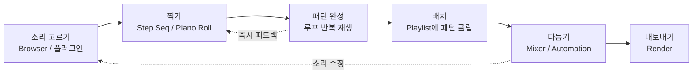

**설계 포인트:** 소리를 고르고 4마디 루프가 울릴 때까지 걸리는 시간을 최소화한다. 첫 비트가 나오기 전에 거쳐야 하는 설정 단계(트랙 생성, 입력 설정, 라우팅 등)가 거의 없다.

---

## 2. 전체 시스템 구조

### 2.1 시스템 맵

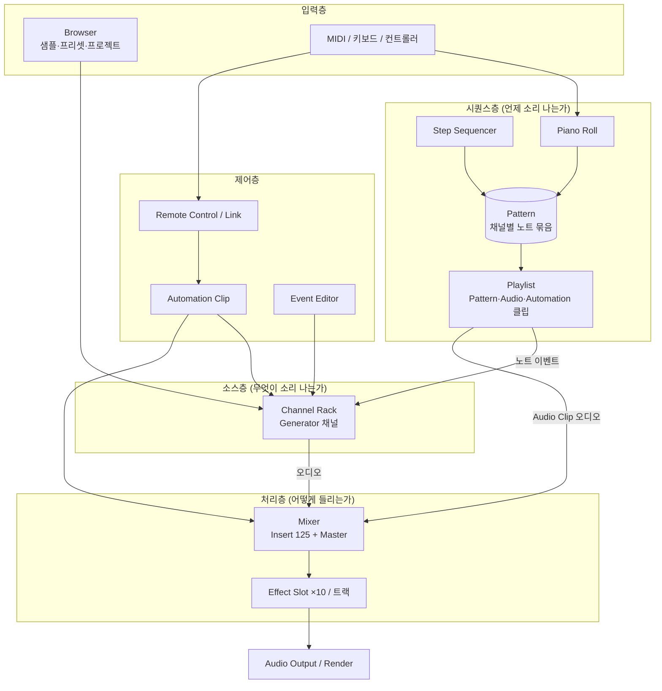

### 2.2 레이어로 나누어 본 책임

| 레이어 | 시스템 | 책임 | 핵심 데이터 |
|---|---|---|---|
| 소스 | Channel Rack | 소리를 만드는 주체(악기·샘플) 관리 | Channel (Generator + 파라미터 + Mixer 라우팅) |
| 시퀀스 (미시) | Step Seq / Piano Roll | 패턴 안의 노트 편집 | Note (pitch, pos, len, vel ...) |
| 시퀀스 (거시) | Pattern / Playlist | 곡 구조 배치 | Clip (source 참조, 위치, 길이, 트랙) |
| 처리 | Mixer | 신호 가공·합산·라우팅 | Insert Track (Slot ×10, Route 목록) |
| 제어 | Automation / Event | 파라미터의 시간 변화 | Event (param ID, time, value) |
| 영속 | .flp | 위의 전부를 이벤트 스트림으로 저장 | TLV 이벤트 |

### 2.3 가장 중요한 구조적 특징: **소스와 시퀀스를 분리**
- 일반적인 DAW(Cubase, Logic 등)에서는 **트랙 = 악기 + 노트 + 믹서 채널**이 한 몸이다.
- FL Studio에서는 이것이 세 군데로 나뉜다.
  - **악기**는 Channel Rack에 있다.
  - **노트**는 Pattern에 있다.
  - **배치**는 Playlist 트랙에 있다. Playlist 트랙에는 정해진 종류가 없다.
- 이 분리 덕분에 FL Studio만의 장점(자유로운 배치, 패턴 재사용)이 생기고, 동시에 대표적인 단점(규모가 커지면 어디에 무엇이 있는지 찾기 어려움)도 생긴다. → 17장 참고

### 2.4 제품 수준의 기획 원칙

각 시스템의 기획 의도를 분석하기 전에, 모든 시스템에 반복해서 나타나는 **상위 원칙 7가지**를 먼저 정리한다. 각 장의 기획 의도 블록은 이 원칙 중 어떤 것을 구현하는지 `P1`~`P7`로 표시한다.

| # | 원칙 | 뜻 | 대표적으로 드러나는 곳 |
|---|---|---|---|
| **P1** | **첫 루프까지의 시간 최소화** | 프로그램을 연 뒤 첫 루프가 울릴 때까지 거치는 단계를 줄인다 | 스텝 시퀀서, PAT 모드, 브라우저 미리듣기 |
| **P2** | **한 번 정의하고 여러 번 쓰기** | 반복되는 음악 구조를 데이터 하나로 만들고 참조한다 | 패턴 참조, Automation 채널, Score/Preset 파일 |
| **P3** | **같은 데이터를 여러 화면으로** | 데이터는 하나, 보는 방법은 숙련도와 목적에 따라 여러 개 | 스텝 ↔ 피아노 롤, Event Editor ↔ Automation Clip |
| **P4** | **구조를 강요하지 않음** | 트랙과 버스의 종류, 작업 순서를 시스템이 정하지 않는다 | 종류 없는 Playlist 트랙, 모든 Insert가 같은 종류 |
| **P5** | **선택한 대상이 곧 작업 맥락** | 지금 고른 패턴이나 채널이 다른 창의 편집 대상을 정한다 | 패턴 선택 → Channel Rack·Piano Roll 내용 교체 |
| **P6** | **대상에서 바로 해결** | 기능을 메뉴에서 찾지 않고, 대상을 오른쪽 클릭하거나 끌어다 놓아 해결한다 | 파라미터 오른쪽 클릭 → 오토메이션, 드래그 앤 드롭 |
| **P7** | **과거 프로젝트를 깨지 않음** | 평생 업데이트를 약속했으므로, 옛 프로젝트가 계속 열려야 한다 | 이벤트 스트림 파일, 오래된 플러그인 유지 |

> **P2와 P4의 긴장:** "한 번 정의하고 참조"(P2)는 데이터 사이에 연결을 만들고, "구조를 강요하지 않음"(P4)은 그 연결을 시스템이 정리해 주지 않는다는 뜻이다. FL Studio의 강점과 약점 대부분이 이 두 원칙이 부딪치는 지점에서 생긴다. 특히 패턴 시스템(6장)에서 가장 뚜렷하다.

### 2.5 기획 의도 분석 형식
각 장 끝의 **기획 의도** 블록은 아래 네 항목으로 정리한다.
- **해결하려는 문제:** 이 시스템이 없거나 다르게 만들었다면 사용자가 겪었을 불편
- **의도한 경험:** 사용자가 느끼기를 바라는 것
- **구현 장치:** 그 경험을 만드는 구체적 기능
- **감수한 비용:** 그 선택 때문에 포기했거나 생긴 문제

---

## 3. 시간 체계 (Timebase / PPQ)

모든 시퀀스 시스템이 공유하는 기반 개념이므로 가장 먼저 정리한다.

### 3.1 구성 요소
| 요소 | 설명 |
|---|---|
| **PPQ** (Pulses Per Quarter note) | 4분음표 하나를 나누는 tick 수. 기본값 96, 설정에서 최대 960까지 변경 가능 [확인] |
| **Tick** | 시간의 최소 단위. 노트·클립·오토메이션 포인트의 위치가 모두 tick 정수로 저장된다 [추정] |
| **Step** | 16분음표 = PPQ / 4 tick (PPQ 96이면 24 tick) |
| **Bar** | 박자표에 따라 결정. 4/4 기준 PPQ × 4 tick |
| **Tempo** | BPM. 마스터 템포는 오토메이션 가능 |
| **Time Signature** | 프로젝트 기본값 + 패턴별 + Playlist 타임 마커로 중간에 변경 가능 [확인] |

### 3.2 tick ↔ 샘플 변환 (추정 구현) [추정]

```
samples_per_tick = (60 / BPM) / PPQ * sample_rate

예) 140 BPM, PPQ 96, 44.1kHz
    = (60/140)/96 * 44100 ≈ 196.875 samples/tick
```

- 템포가 바뀌는 구간에서는 템포 맵을 구간별로 적분해 tick 위치를 절대 샘플 위치로 바꾼다.
- **스윙**은 Channel Rack의 Swing 노브로 조정하며, 짝수 번째 16분 스텝의 시작 위치를 뒤로 미루는 오프셋이다. 채널마다 적용 여부를 정할 수 있다 [확인]

### 3.3 기획 의도 `P1` `P7`
| 관점 | 내용 |
|---|---|
| 해결하려는 문제 | 노트, 클립, 오토메이션이 각자 다른 시간 단위를 쓰면 스냅과 퀀타이즈가 어긋난다 |
| 의도한 경험 | 어느 창에서 무엇을 옮겨도 같은 그리드에 딱 맞는다 |
| 구현 장치 | 모든 시퀀스 데이터를 정수 tick 하나로 통일하고, 스텝 = PPQ/4로 고정 |
| 감수한 비용 | 오디오 클립은 tick 그리드와 샘플 정밀도 사이를 오가며 변환해야 한다. 그래서 오디오 클립 위치는 내부적으로 더 정밀한 값으로 보관할 가능성이 높다 [추정]. 또 PPQ 기본값 96은 MIDI 연주를 녹음할 때 미세한 타이밍을 잃을 수 있어 설정에서 올릴 수 있게 했다 |

- **스윙을 채널 단위로 끄고 켜게 한 이유:** 하이햇에는 스윙을 걸고 킥은 정박에 두는 힙합식 그루브를 노브 하나로 만들기 위해서다. 장르 타깃이 기능 단위까지 반영된 사례다.

---

## 4. 채널 랙 & 스텝 시퀀서

### 4.1 목적
**"소리를 내는 것들의 목록"**이자 **가장 빠른 입력 도구**.

### 4.2 Channel 데이터 구조 (추정) [추정]

```ts
interface Channel {
  id: number;
  name: string;
  color: RGB;
  type: 'Sampler' | 'Plugin' | 'AudioClip' | 'Automation' | 'Layer' | 'MIDIOut';
  generator: PluginInstance | SampleRef;   // 실제 소리를 내는 주체
  mixerTarget: number;                     // 연결된 Mixer Insert 번호 (0 = Master)
  // 공통 채널 파라미터 (Channel Settings 창)
  volume: number; pan: number; pitch: number;
  filterGroup: string;                     // Channel Rack 필터 그룹
  swingEnabled: boolean;
  envelopes?: EnvelopeLFO[];               // Sampler의 INS 탭 등
  arpeggiator?: ArpSettings;
  timeOffset?: { pos: number; vel: number; ... }; // MISC 탭
}
```

### 4.3 채널 타입
| 타입 | 역할 |
|---|---|
| **Sampler** | 오디오 샘플을 재생하는 기본 악기. 브라우저에서 샘플을 끌어다 놓으면 생성된다 |
| **Plugin (Generator)** | 신스 등 악기 플러그인 (FLEX, Sytrus, Harmor, VST 등) |
| **Audio Clip** | Playlist에 놓을 오디오 클립의 원본 소스 채널 |
| **Automation Clip** | 오토메이션 클립도 채널로 등록된다 (아래 9장) |
| **Layer** | 여러 채널을 하나의 노트로 동시에 울린다 |
| **MIDI Out** | 외부 장비나 다른 플러그인으로 MIDI를 보낸다 |

> **핵심 관찰:** 오디오 클립과 오토메이션 클립도 **채널**로 존재한다. FL Studio에서 "타임라인 위의 모든 것은 Channel Rack에 원본이 있다"는 일관된 규칙이다.

### 4.4 스텝 시퀀서 작동 원리
1. 각 채널 행에 기본 16개 스텝 버튼이 있다 (패턴 길이에 따라 늘어난다).
2. 스텝을 켜면 **해당 위치에 기본 길이의 노트가 생긴다.** 스텝은 별도 데이터가 아니라 **피아노 롤 노트를 보여주는 다른 방식**이다 [추정]
   - 근거: 스텝을 찍은 뒤 피아노 롤을 열면 같은 노트가 보인다. 반대로 피아노 롤에서 노트 길이나 음높이를 바꾸면 스텝 모드 표시가 피아노 롤 미리보기로 바뀐다.
3. **Graph Editor**에서 스텝마다 velocity, pan, release, fine pitch, mod X/Y, shift를 조정한다. 이것은 노트 속성을 그대로 편집하는 것이다.

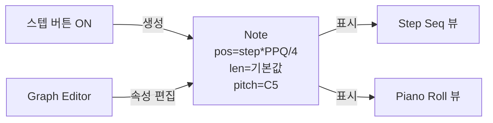

### 4.5 기획 의도 `P1` `P3` `P5`
| 관점 | 내용 |
|---|---|
| 해결하려는 문제 | 일반 DAW는 드럼 하나를 찍으려 해도 트랙 생성 → 악기 로드 → MIDI 클립 생성 → 편집기 열기를 거쳐야 한다 |
| 의도한 경험 | 하드웨어 드럼 머신(TR 시리즈)처럼 **버튼을 누르면 곧 리듬**이 된다. 음악 이론을 몰라도 첫 비트를 완성한다 |
| 구현 장치 | 기본 템플릿에 Kick·Clap·Hat·Snare 채널이 미리 들어 있다. 클릭 한 번이 노트 하나이고, 그래프 에디터로 세기를 조정한다 |
| 감수한 비용 | 채널이 많아지면 세로 목록이 길어져 정리가 어렵다 → Filter Group, 채널 색상, 접기 기능으로 보완 |

- **같은 데이터, 여러 화면:** 스텝 시퀀서, 피아노 롤, Channel Rack 미니 미리보기는 모두 같은 노트 데이터를 보여준다. 입문자는 스텝으로 시작해 별도의 데이터 변환 없이 피아노 롤로 넘어간다. → **화면은 숙련도에 맞추어 늘어나지만 데이터는 하나**라는 학습 곡선 설계.
- **Channel Rack을 따로 둔 이유:** 소리 원본을 한곳에 모아 두면 "이 곡에 쓰인 악기 목록"이 곧 Channel Rack이 된다. 비트메이커는 곡보다 **키트(악기 묶음) 단위**로 생각하는 경우가 많다는 점을 반영했다.
- **Audio·Automation 클립까지 채널로 만든 이유:** "타임라인 위의 모든 것은 Channel Rack에 원본이 있다"는 규칙 하나로 규칙 수를 줄였다. 덕분에 Playlist는 클립 종류에 상관없이 똑같이 동작한다.

---

## 5. 피아노 롤

### 5.1 목적
업계에서 가장 강력하다고 평가받는 노트 편집기. 하나의 **채널 × 하나의 패턴**에 들어 있는 노트를 편집한다.

### 5.2 Note 데이터 구조 [확인] (Piano Roll 노트 속성 기준)

```ts
interface Note {
  position: number;     // tick
  length: number;       // tick
  key: number;          // MIDI 노트 번호
  velocity: number;     // 0~128 (기본 100)
  release: number;      // 릴리스 벨로시티
  pan: number;
  fineP: number;        // 미세 음높이 (±1 반음, cent 단위)
  modX: number;         // 자유 매핑 가능한 Mod X
  modY: number;         // 자유 매핑 가능한 Mod Y
  color: number;        // 0~15, MIDI 채널 역할도 겸한다
  slide: boolean;       // 슬라이드 노트
  porta: boolean;       // 포르타멘토
  group?: number;       // 노트 그룹
}
```

**관찰 포인트:** `color`가 **보기용 색상**과 **MIDI 채널(1~16)** 역할을 동시에 한다. 그래서 한 피아노 롤에서 다채널 VST에 노트를 나누어 보낼 수 있다.

### 5.3 주요 기능과 원리
| 기능 | 작동 원리 |
|---|---|
| **Ghost Notes** | 같은 패턴에 있는 다른 채널의 노트를 반투명하게 겹쳐 보여준다. 화음과 멜로디를 맞출 때 참고용 |
| **Slide Notes** | 슬라이드 노트가 끝나는 지점까지 이전 노트의 음높이를 미끄러뜨린다. 노트에 플래그만 붙이는 방식이라 플러그인이 해석해야 한다 (네이티브 신스는 완전 지원) |
| **Scale Highlighting / Snap to Scale** | 선택한 스케일의 음만 표시하고 그 음에만 맞춘다 |
| **Tools 메뉴** | 노트 배열을 바꾸는 함수들: `Chop`, `Arpeggiate`, `Strum`, `Quantize`, `Flip`, `Randomize`, `Riff Machine`, `Limit`, `Scale Levels`, `Articulate` 등 |
| **Chord Stamp** | 노트 하나를 입력하면 선택한 코드 구성음이 한꺼번에 생성된다 |
| **Event Lane** (하단) | 노트 속성(velocity 등)과 채널 파라미터 이벤트를 그래프로 편집한다 |
| **Piano Roll Scripting** (Python) | 2023년 이후 Python 스크립트로 노트를 생성하거나 바꿀 수 있다 [확인] |

### 5.4 노트 → 사운드 변환 흐름

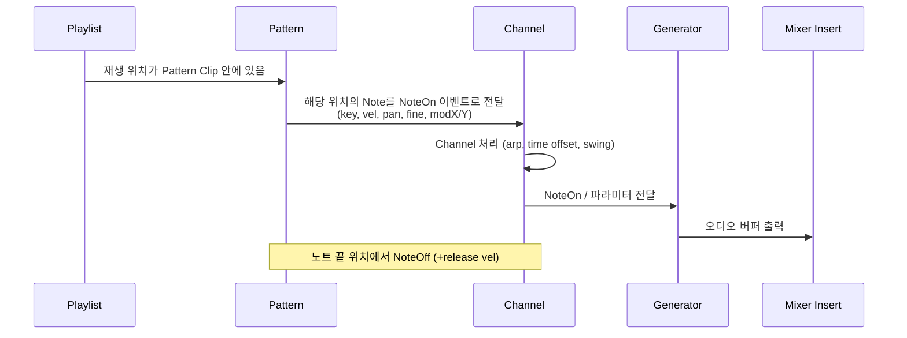

### 5.5 기획 의도 `P3` `P6`
| 관점 | 내용 |
|---|---|
| 해결하려는 문제 | 오선 악보를 못 읽는 사용자도 멜로디와 코드를 정확히 만들고 고쳐야 한다 |
| 의도한 경험 | **"악보 대신 그림을 그린다."** 음악 이론은 도구가 대신해 준다 (스케일 강조, 코드 스탬프, Riff Machine) |
| 구현 장치 | 노트마다 표현 속성 10개 이상, 노트 배열을 바꾸는 Tools, 고스트 노트, Python 스크립트 |
| 감수한 비용 | 오선 악보 화면이 없다 → 연주자와 악보를 주고받으려면 외부 프로그램이 필요하다 (13장). Slide·Mod X/Y 같은 FL 전용 속성은 외부로 나가면 사라진다 |

- **노트에 속성을 많이 담은 이유:** 일반 DAW는 피치 벤드나 모듈레이션을 별도 CC 레인에 그린다. FL Studio는 **노트 하나에 표현 정보를 붙여** 노트를 옮기면 표현도 함께 따라오게 했다. 편집 단위를 "노트"로 통일한 결정이다.
- **색상을 MIDI 채널로 겸용한 이유:** 화면용 속성과 신호용 속성을 하나로 합쳐 속성 수를 줄였다. 사용자는 "빨간 노트는 현악, 파란 노트는 관악"처럼 눈으로 구분하면서 동시에 다채널 악기에 노트를 나누어 보낸다.
- **고스트 노트의 의미:** 피아노 롤은 채널 하나만 편집하는 화면이지만, 패턴(6장)이 여러 채널을 묶고 있기 때문에 **같은 패턴 안 다른 채널의 노트를 공짜로 보여줄 수 있다.** 패턴 구조가 편집기 기능을 낳은 사례다.

---

## 6. 패턴 시스템 (심화 분석)

> FL Studio의 정체성을 만드는 시스템이다. 다른 모든 시스템(채널 랙, 피아노 롤, 플레이리스트, 공유)이 패턴을 중심으로 설계되어 있으므로 가장 자세히 분석한다.

### 6.1 패턴이란? — FL Studio에서 가장 오해받는 개념
- 패턴은 **"하나의 트랙에 들어 있는 MIDI 클립"이 아니다.**
- 패턴은 **"Channel Rack 전체에 대한 노트 묶음"**이다. 즉 **채널 × 패턴 행렬**에서 열 하나에 해당한다.

```
               Pattern 1   Pattern 2   Pattern 3 (Chorus)
               (Verse)     (Break)
Kick           ■ ■ ■ ■     ■ □ ■ □     ■ ■ ■ ■
Snare          □ ■ □ ■     □ ■ □ ■     □ ■ □ ■
Hat            ■■■■■■■■    -           ■■■■■■■■
Lead Synth     -           ooo         oooo
Bass           o           o           oo
```

- 위 표에서 **열(세로) = 패턴**, **행(가로) = 채널**, **칸 하나 = 노트 목록**이다.
- 사용자가 보는 화면은 이 행렬을 서로 다른 방향으로 잘라 보여준다.

| 화면 | 행렬을 자르는 방향 |
|---|---|
| Channel Rack (스텝) | 열 하나 (현재 패턴) 전체 |
| Piano Roll | 칸 하나 (현재 패턴 × 선택 채널) + 같은 열의 다른 칸을 고스트로 |
| Playlist | 열들을 시간 축 위에 배치 |
| Pattern 목록 | 열 머리글 목록 |

### 6.2 기원: 하드웨어 드럼 머신의 Pattern / Song 구조
- Roland TR 시리즈, Akai MPC 같은 드럼 머신은 **Pattern(1~2마디 리듬, 모든 악기 포함)**을 여러 개 만들고, **Song(패턴 번호를 나열한 체인)**으로 곡을 완성했다.
- FruityLoops는 이 구조를 소프트웨어로 옮겼다. 그래서 패턴이 **"트랙의 조각"이 아니라 "모든 악기를 담은 한 마디"** 단위가 된 것이다 [확인]
- 이후 피아노 롤, 오디오 클립, 자동화가 추가되면서도 이 기본 단위는 바뀌지 않았다 (P7). 지금의 패턴 시스템은 **드럼 머신 모델 위에 범용 DAW 기능을 덧붙인 결과**로 읽어야 한다.

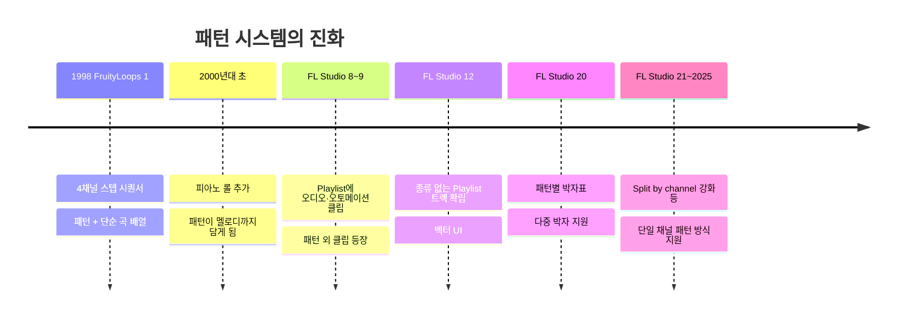
※ 세부 버전 시점은 대략적인 흐름이며 정확한 버전과 다를 수 있다.

### 6.3 데이터 구조 (추정) [추정]

```ts
interface Pattern {
  id: number;                    // 1 ~ 999 (패턴 번호 = 목록 위치)
  name: string;
  color: RGB;
  length: number | 'auto';       // 기본은 내용으로 자동 결정
  timeSignature?: [n: number, d: number]; // FL 20+ 패턴별 박자표 [확인]
  notes:  Map<ChannelId, Note[]>;              // 칸 = (패턴, 채널)의 노트 목록
  events: Map<ParamId, AutomationEvent[]>;     // 패턴 이벤트 (9장)
}

interface PatternClip {           // Playlist에 놓인 패턴 인스턴스
  patternId: number;              // ← 참조. 노트를 복사하지 않는다
  position: number;               // Playlist 위치 (tick)
  length: number;                 // 클립 길이 (패턴 길이와 다를 수 있음)
  startOffset: number;            // 패턴 안 어느 지점부터 재생할지
  track: number;
}
```

**핵심 관계**
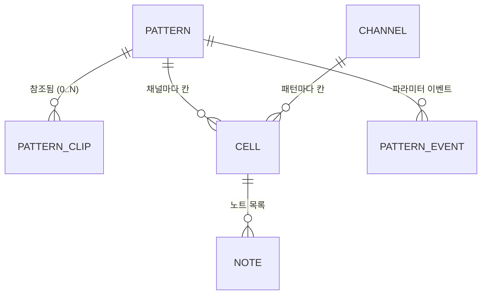
- `채널`과 `패턴`은 **다대다** 관계이고, 그 교차점(CELL)에 노트가 있다.
- 노트의 소유자는 채널도 패턴도 아닌 **(채널, 패턴) 쌍**이다. 이 점이 다른 DAW와 가장 크게 다르다.

### 6.4 패턴 길이 규칙
| 규칙 | 동작 |
|---|---|
| **자동 길이 (기본)** | 마지막 노트가 끝나는 지점을 **마디 단위로 올림**한 값이 패턴 길이가 된다 [확인] |
| 빈 패턴 | 기본 길이(1마디)로 취급 [추정] |
| 스텝 수 | Channel Rack의 스텝 수가 패턴 길이에 맞추어 늘어난다 |
| 박자표 | 패턴에 박자표를 따로 줄 수 있다. 없으면 프로젝트 기본값 |

- **자동 길이를 기본으로 둔 이유:** 사용자가 길이를 따로 정하지 않아도 "찍은 만큼"이 루프 길이가 된다 (P1). 드럼 머신의 "1~4마디 루프" 감각을 그대로 살린다.
- **위험:** 노트 하나를 실수로 5마디째에 찍으면 패턴 길이가 8마디로 늘어나고, 이 패턴을 쓰는 클립의 반복 간격이 모두 바뀐다.

### 6.5 패턴 클립과 패턴의 관계: 참조, 자르기, 반복
| 조작 | 결과 | 패턴 데이터 변화 |
|---|---|---|
| 패턴을 Playlist에 그리기 | 같은 `patternId`를 가진 클립 생성 | 없음 |
| 클립 복사 (Ctrl+드래그 등) | 같은 패턴을 가리키는 클립이 하나 더 생김 | 없음 |
| 클립 자르기 (Slice) | 두 클립이 같은 패턴을 가리키고 `startOffset`만 다름 [추정] | 없음 |
| 클립 오른쪽 끝을 늘리기 | 패턴 길이보다 길어지면 패턴 내용이 **반복** 재생 [추정] | 없음 |
| 클립에서 패턴 열고 노트 수정 | 이 패턴을 쓰는 **모든 클립**의 소리가 바뀜 | 패턴 수정 |
| **Make Unique** | 패턴을 복제(새 번호)하고 이 클립만 새 패턴을 가리키게 함 [확인] | 패턴 하나 추가 |
| **Clone pattern** | 패턴 목록에서 복제본 생성 (클립 참조는 그대로) | 패턴 하나 추가 |
| **Split by channel** | 패턴을 채널별 패턴으로 나누고 클립도 채널별로 바꿔 놓음 [확인] | 패턴 N개 추가 |
| **Consolidate (Render to audio)** | 클립 구간을 오디오로 렌더해 Audio Clip으로 바꿈 [확인] | 오디오 채널 추가 |

**클립 상태 전이**
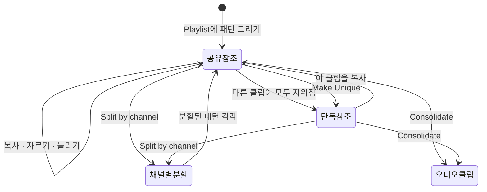

### 6.6 "현재 패턴"이라는 전역 편집 맥락 (P5)
- FL Studio에는 늘 **선택된 패턴 하나**가 있다 (툴바의 Pattern Selector).
- 이 값 하나가 여러 창의 내용을 동시에 바꾼다.

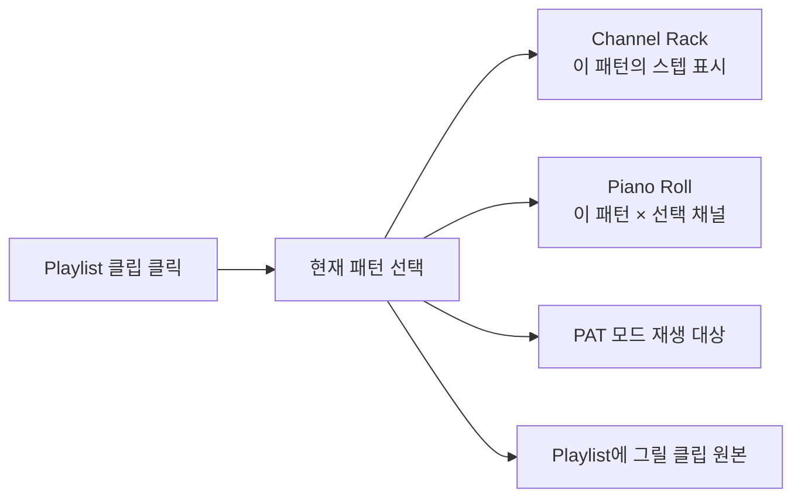

- **장점:** Playlist의 클립을 클릭하면 곧바로 그 패턴이 편집 대상이 된다. 창을 오가며 "무엇을 편집 중인가"를 따로 지정할 필요가 없다.
- **함정:** 패턴을 바꾼 줄 모르고 스텝을 찍으면 **엉뚱한 패턴**에 노트가 들어간다. 입문자가 가장 자주 겪는 실수 중 하나다.
- **함정 2:** Channel Rack에서 채널을 지우면 그 채널의 **모든 패턴 속 노트**가 함께 사라진다 (행 하나 전체 삭제). 화면에는 현재 패턴만 보이므로 피해 범위가 잘 보이지 않는다.

### 6.7 재생 처리 (추정) [추정]
```text
for clip in playlist.clips_overlapping(t0, t1):
    pat = patterns[clip.patternId]
    L   = pat.length
    for (channel, notes) in pat.notes:
        for note in notes:
            # 클립 안에서 패턴이 반복될 수 있으므로 반복 회차 k마다 계산
            for k in repeats_in_range(clip, L, t0, t1):
                t = clip.position - clip.startOffset + k*L + note.position
                if t0 <= t < t1 and inside(clip, t):
                    emit NoteOn(channel, note, at=t)
```
- 같은 패턴 클립 두 개를 **같은 시간에 겹쳐 놓으면** 노트가 두 번 울려 소리가 두 배로 커진다. 시스템이 막지 않는다 (P4).
- 패턴에 들어 있는 **채널별 노트가 모두 원래 채널로** 간다. 그래서 클립을 어느 Playlist 줄에 놓든 소리는 같다 (7.7).

### 6.8 두 가지 작업 방식과 그 사이
| 방식 | 설명 | 장점 | 단점 |
|---|---|---|---|
| **멀티 채널 패턴** (전통적) | 패턴 하나 = 드럼 전체 루프, 또는 한 섹션 전체 | 루프 단위로 빠르게 조립. 패턴 수가 적다 | 악기 하나만 바꾼 변주를 만들면 패턴 전체를 복제해야 한다 |
| **단일 채널 패턴** (현대적) | 패턴 하나 = 채널 하나 | 트랙 기반 DAW처럼 정리된다. 악기별 변주가 쉽다 | 패턴 수가 크게 늘어난다. 고스트 노트 효과가 줄어든다 |
| **혼합** (실제로 많음) | 드럼은 멀티 채널, 멜로디·베이스는 단일 채널 | 장르에 맞게 최적화 | 규칙이 사람마다 달라 협업 시 혼란 |

**변주 문제로 보는 차이** — "Chorus 마지막 마디만 하이햇을 바꾸고 싶다"
- 멀티 채널 패턴: 패턴 전체 Make Unique → Kick·Snare까지 복제됨 → 이후 Kick을 고치면 두 패턴을 모두 고쳐야 한다.
- 단일 채널 패턴: Hat 패턴만 Make Unique → 나머지는 계속 공유.
- → **"공유 단위를 얼마나 잘게 나누는가"**가 이 두 방식의 본질적 차이다. FL Studio는 이 결정을 사용자에게 맡겼다 (P4).

### 6.9 패턴 모드와 곡 모드
- **PAT 모드:** 현재 선택된 패턴만 반복 재생한다. 루프를 만들 때 쓴다.
- **SONG 모드:** Playlist 전체를 재생한다.
- 트랜스포트의 토글 하나로 바꾼다. "루프 만들기"와 "곡 만들기"를 오가는 FL Studio 고유의 작업 리듬이다.

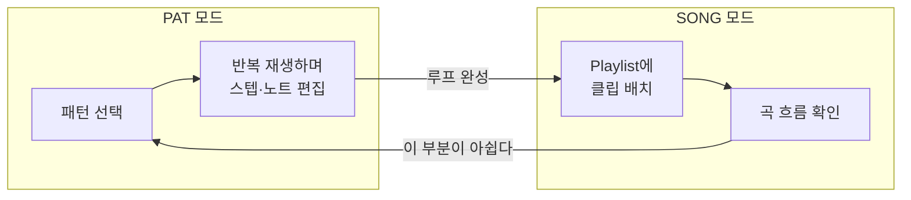

### 6.10 다른 DAW의 "재사용 클립"과 비교
| DAW | 재사용 방식 | 기본 동작 | 재사용 단위 |
|---|---|---|---|
| **FL Studio** | Pattern Clip | **참조가 기본** (복사하려면 Make Unique) | 여러 채널 묶음 가능 |
| Logic Pro | Alias / Loop | **복사가 기본** (Alias는 별도 명령) | 트랙 하나 |
| Cubase | Shared Copy | 복사가 기본 (Shared Copy는 별도 명령) | 트랙 하나 |
| Ableton Live | Linked clip 없음 (Arrangement는 복사) [추정] | 복사 | 트랙 하나 |

- FL Studio만 **참조를 기본값**으로 둔다. 루프를 반복하는 장르(힙합·EDM)에서는 "모든 반복을 한꺼번에 고치기"가 "한 곳만 고치기"보다 훨씬 자주 일어난다는 판단으로 보인다.
- 반대로 반복이 적은 장르(영화 음악, 밴드 녹음)에서는 이 기본값이 의도하지 않은 수정을 일으킨다.

### 6.11 기획 의도 종합 `P1` `P2` `P5` `P4`
| 관점 | 내용 |
|---|---|
| 해결하려는 문제 | 반복이 많은 장르에서 같은 루프를 수십 번 복사해 두면, 한 군데를 고칠 때 모든 복사본을 찾아 고쳐야 한다 |
| 의도한 경험 | **"루프를 하나 만들고, 블록처럼 쌓는다."** 고칠 때는 하나만 고치면 곡 전체에 반영된다 |
| 구현 장치 | 참조 기본값, 자동 길이, PAT/SONG 토글, 현재 패턴 맥락, Make Unique·Split by channel |
| 감수한 비용 | ① 의도하지 않은 전체 수정 ② 패턴 수 증가와 관리 부담 ③ 노트 소유자가 (채널, 패턴) 쌍이라 "이 악기의 노트가 어디 있나"를 한눈에 보기 어렵다 ④ 트랙 기반 DAW에서 넘어온 사용자에게 낯설다 |

### 6.12 패턴 시스템 리스크와 개선 제안
| 리스크 | 현재 대응 | 개선 제안 |
|---|---|---|
| 공유 패턴을 모르고 수정 | 없음 (같은 색이면 눈치로 파악) | 피아노 롤 상단에 **"이 패턴은 Playlist 7곳에서 사용 중"** 배지. 수정 시 "모두 / 이 클립만" 선택지 |
| 패턴 남발 (Pattern 1~200) | 이름, 색상, 정렬 | 사용 횟수 0인 패턴 표시, 일괄 정리, 폴더(그룹) |
| 노트가 어디 있는지 모름 | 채널 선택 → Playlist에서 관련 클립 선택 기능 일부 | 채널을 고르면 그 채널의 노트가 들어 있는 패턴과 클립을 모두 강조 |
| 엉뚱한 패턴에 입력 | 툴바 패턴 이름 표시 | 편집 중인 패턴이 Playlist에서 쓰이지 않으면 경고 표시 |
| 채널 삭제 시 모든 패턴 노트 삭제 | Undo | 삭제 전 "패턴 N개에서 노트 M개가 사라집니다" 확인 |

---

## 7. 플레이리스트 & 클립 시스템

### 7.1 목적
곡 전체의 시간 축 위에 클립을 배치하는 **거시 편곡기**.

### 7.2 핵심 원리: **종류가 정해지지 않은 트랙**
- Playlist 트랙(최대 500개 [확인])에는 정해진 소스나 타입이 없다.
- 한 트랙에 Pattern Clip, Audio Clip, Automation Clip을 섞어서 놓을 수 있다.
- **Playlist 트랙은 Mixer와 연결되지 않는다.** 오디오 라우팅은 클립의 원본 채널이 정한다.
  - 즉 Playlist 트랙은 **시각적인 정리용 줄**일 뿐 신호 경로가 아니다.
  - (FL 2024 이후 트랙 그룹이나 트랙에서 Mixer로 연결하는 보조 기능이 일부 추가됐지만 기본 원리는 같다.)

### 7.3 Clip 데이터 구조 (추정) [추정]

```ts
interface PlaylistItem {
  trackIndex: number;
  position: number;      // tick
  length: number;        // tick
  startOffset: number;   // 원본 안에서 시작 지점 (잘라낸 클립)
  source:
    | { kind: 'pattern'; patternId: number }
    | { kind: 'channel'; channelId: number }; // Audio / Automation Clip
  muted: boolean;
  group?: number;
}
```

### 7.4 클립 종류
| 클립 | 원본 | 특징 |
|---|---|---|
| Pattern Clip | Pattern | 참조 방식, Make Unique 지원 |
| Audio Clip | Audio Clip 채널 (샘플) | 타임 스트레치(élastique), 리샘플, 페이드, 리버스 |
| Automation Clip | Automation 채널 | 연결된 파라미터에 값을 보낸다 |

### 7.5 부가 기능
- **Time Marker:** 섹션 이름, 박자 변경, 루프 구간, 펀치 인/아웃 지점 표시.
- **Performance Mode:** Playlist의 각 칸을 런처처럼 사용한다 (Ableton Session View와 비슷한 라이브 연주용).
- **Pattern Picker / Clip Source Selector:** 그려 넣을 클립 원본을 고른다.

### 7.6 재생 시 처리 순서 (추정) [추정]
1. 현재 재생 위치에 걸치는 클립을 찾는다 (구간 트리나 정렬된 목록에서 탐색).
2. Pattern Clip이면 `노트 위치 = clip.position - clip.startOffset + note.position`으로 바꿔 이번 오디오 버퍼 범위 안에 있는 노트만 꺼낸다.
3. 꺼낸 노트를 원본 채널에 NoteOn/Off로 보낸다. 같은 채널을 여러 클립이 동시에 쓰면 모든 노트가 그 채널 하나로 모인다.

### 7.7 기획 의도 `P4` `P2`
| 관점 | 내용 |
|---|---|
| 해결하려는 문제 | 트랙 기반 DAW에서는 "드럼 트랙", "베이스 트랙"처럼 트랙 종류와 소리 경로를 먼저 정해야 편곡을 시작할 수 있다 |
| 의도한 경험 | **블록 쌓기.** 패턴을 아무 줄에나 놓으며 곡 구조를 눈으로 짠다. 줄은 그저 화면 정리용이다 |
| 구현 장치 | 종류 없는 트랙, 클립은 원본을 참조, 오디오 경로는 채널이 정함 |
| 감수한 비용 | Playlist 트랙에서 바로 뮤트·솔로·이펙트를 걸 수 없다 (트랙 뮤트는 화면상 클립만 끈다). 소리를 다루려면 Mixer로 가야 한다 |

- **Playlist 트랙을 신호 경로에서 뺀 이유:** 같은 패턴을 Intro에서는 1번 줄, Chorus에서는 5번 줄에 둬도 소리가 같아야 한다. 트랙이 신호 경로였다면 놓는 줄에 따라 소리가 달라져 "블록 쌓기" 경험이 깨진다.
- **Performance Mode를 별도 화면이 아닌 Playlist 안에 둔 이유:** 새 화면과 새 데이터 구조를 만들지 않고, 같은 클립 데이터를 **재생 방식만 바꾸어** 라이브 런처로 쓴다 (P3).

---

## 8. 믹서 & 라우팅

### 8.1 구성 [확인]
- **Insert Track 125개 + Master + Current** (FL 20 이후).
- 트랙마다 **이펙트 슬롯 10개**, EQ 3밴드, 볼륨·팬·스테레오 분리, 위상 반전, 좌우 바꾸기.
- 트랙마다 **입력·출력 오디오 장치**를 지정할 수 있다 (녹음 입력과 외부 출력).

### 8.2 라우팅 모델: **자유 그래프**
- 어느 트랙이든 다른 트랙으로 보낼 수 있다 (Send / Sidechain). 기본으로는 모든 Insert가 Master로 간다.
- "Route to this track only" / "Sidechain to this track" 두 가지가 있다.
  - Route: 오디오를 보낸다 (send 레벨 노브 포함).
  - Sidechain: 신호는 보내지만 도착한 트랙의 **사이드체인 입력**으로만 쓴다 (Fruity Limiter 등에서 선택).
- 별도의 Send/Bus/Aux 트랙 타입이 없다. **모든 Insert가 같은 종류**이고 연결 방식으로만 역할이 정해진다.

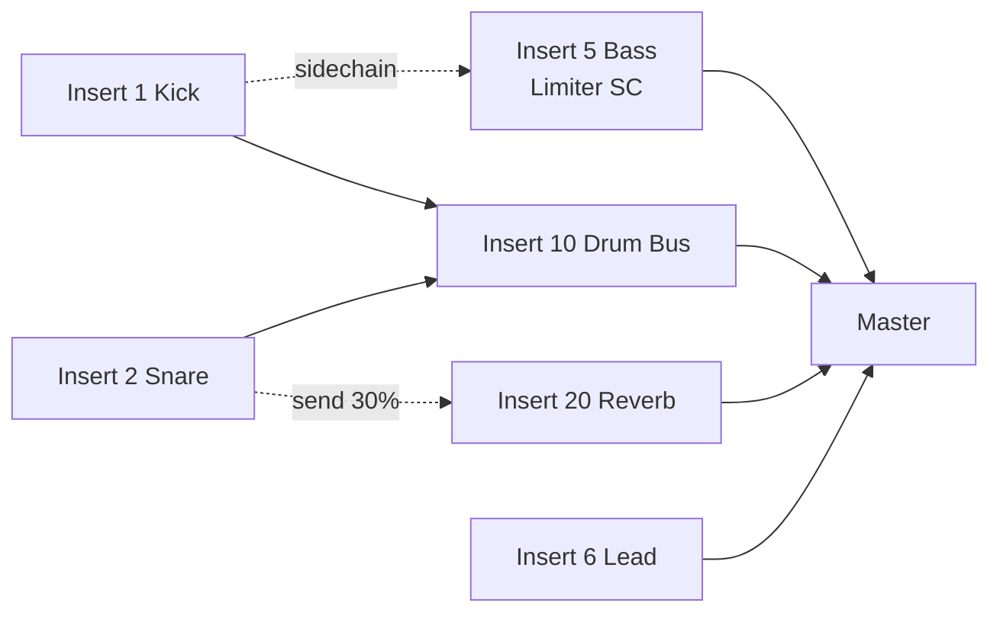

### 8.3 그래프 처리 원리 (추정) [추정]
1. **위상 정렬:** 라우팅 그래프를 DAG로 보고 처리 순서를 정한다. 순환 연결은 UI 단계에서 막는다.
2. **병렬 처리:** 서로 의존하지 않는 Insert는 여러 CPU 코어에 나누어 동시에 처리한다 (멀티코어 Mixer 처리 옵션 [확인]).
3. **PDC (Plugin Delay Compensation):** 경로마다 플러그인 지연을 합산하고, 가장 늦는 경로에 맞추어 다른 경로를 지연시켜 맞춘다 [확인] (자동 PDC + 트랙별 수동 지연 보정).
4. 각 Insert 내부 순서: `입력 합산 → Slot 1 → … → Slot 10 → EQ → 볼륨/팬 → 출력 송신`.

### 8.4 Channel → Mixer 연결
- 채널마다 `mixerTarget` 번호를 가진다. Channel Rack 왼쪽의 숫자 칸이 바로 그 번호다.
- 연결 안 된 채널(0)은 바로 Master로 간다. 입문자가 **이펙트 처리를 못 하는 상태로 남기 쉬운** 대표적인 함정이다.
- 개선 흐름: 채널을 선택하고 `Ctrl+L`을 누르면 빈 Insert에 자동으로 연결된다. 최근 버전에는 "새 채널을 빈 Insert에 자동 연결" 옵션이 생겼다 [확인]

### 8.5 기획 의도 `P4` `P6`
| 관점 | 내용 |
|---|---|
| 해결하려는 문제 | Bus, Aux, Return, Group 같은 트랙 종류의 차이를 입문자가 이해해야 믹싱을 시작할 수 있다 |
| 의도한 경험 | **"트랙은 그냥 트랙."** 연결선만 바꾸면 버스도, 리턴도, 사이드체인 소스도 된다 |
| 구현 장치 | 125개 Insert가 모두 같은 종류. 트랙 아래쪽 화살표 클릭으로 연결, 오른쪽 클릭으로 사이드체인 |
| 감수한 비용 | 화면만 보고는 트랙의 역할을 알 수 없다 → 이름과 색상으로 사용자가 직접 정리해야 한다. 채널과 Insert 번호를 따로 맞춰야 하는 수고도 생긴다 |

- **사이드체인을 한 번 클릭으로:** EDM과 트랩의 "펌핑" 효과는 장르의 핵심 소리다. 타깃 장르에서 가장 자주 쓰는 기법을 가장 쉬운 조작에 배치했다.
- **슬롯을 10개로 고정한 이유 (추정):** 슬롯 수를 정해 두면 화면 배치가 늘 같고, 파라미터 ID 체계(`Insert / Slot / Param`)가 단순해진다 [추정]. 더 많은 이펙트가 필요하면 Patcher나 다른 Insert로 이어서 해결한다.

---

## 9. 오토메이션 & 이벤트 시스템

FL Studio에는 파라미터를 시간에 따라 움직이는 방법이 **세 갈래**로 있다. 이 다양함이 강점이자 복잡함의 원인이다.

### 9.1 파라미터 주소 체계 (추정) [추정]
- 오토메이션 가능한 모든 파라미터에는 **고유 ID**가 붙는다: `(대상 종류, 대상 인덱스, 파라미터 인덱스)`.
  - 예: `Channel 3 / Volume`, `Mixer 5 / Slot 2 / Param 17`, `Master Tempo`.
- 마우스 오른쪽 클릭 메뉴의 "Create automation clip", "Edit events", "Link to controller"가 모두 같은 ID를 대상으로 동작한다.

### 9.2 세 가지 방식

| 방식 | 데이터 | 저장 위치 | 용도 |
|---|---|---|---|
| **Automation Clip** | 포인트 + 텐션(곡선) | Channel Rack의 Automation 채널 + Playlist 클립 | 곡 단위의 큰 변화 (필터 스윕, 볼륨 페이드) |
| **Event (Pattern Event)** | 고밀도 이벤트 목록 | Pattern 안 | 실시간 녹음한 손잡이 움직임, 패턴 단위 반복 |
| **Remote Control / Link** | 입력 → 매핑 함수 → 파라미터 | 프로젝트 / 전역 | MIDI 컨트롤러, 내부 컨트롤러(Peak/Formula/Fruity LFO) |

### 9.3 Automation Clip 원리
```ts
interface AutomationClip {
  target: ParamId[];          // 여러 파라미터에 동시에 연결 가능
  points: { pos: number; value: number /*0~1*/; tension: number; mode: CurveMode }[];
  lfo?: { tension; speed; amount ... };   // 클립 자체 LFO
  // Playlist 클립이 이 채널을 참조 → 클립 길이·오프셋에 따라 재생
}
```
- 재생할 때 **현재 위치를 앞뒤 포인트 사이에 넣고 텐션 곡선으로 보간한 값**을 파라미터에 보낸다.
- 값은 0~1로 정규화된 상태로 저장하고, 대상 파라미터의 범위(dB, Hz 등)로 바꾸는 일은 파라미터가 맡는다 [추정]
- **Initial value 문제:** 클립이 없는 구간에서는 마지막 값이 유지된다. 그래서 "클립 시작 전의 값"을 정하는 옵션이 따로 있다.

### 9.4 Internal Controller (모듈레이션 소스)
- **Fruity Peak Controller:** 오디오 레벨을 컨트롤 신호로 바꾼다 → 사이드체인 덕킹.
- **Fruity Formula Controller:** 수식으로 컨트롤 신호를 만든다.
- **Fruity LFO / Patcher 매핑:** 모듈레이션 경로를 직접 구성한다.
- 이것들은 **오디오 플러그인처럼 Mixer 슬롯에 들어가지만** 출력은 "Link to controller" 목록에 나타나는 **컨트롤 소스**다. 오디오 그래프와 컨트롤 그래프가 같은 플러그인 슬롯 체계를 함께 쓰는 셈이다.

### 9.5 Link to Controller 매핑
```
입력(0~1) → Mapping Formula (예: "Input^2", 사용자 수식) → Smoothing → 파라미터(0~1)
```
- 매핑 곡선과 수식을 지원하므로 단순 1:1 연결이 아닌 비선형 제어도 가능하다 [확인]

### 9.6 기획 의도 `P6` `P2` `P3`
| 관점 | 내용 |
|---|---|
| 해결하려는 문제 | 오토메이션 레인이 트랙에 붙어 있으면, 트랙이 없는 대상(마스터 템포, 플러그인 내부 값 여러 개)은 자동화하기 번거롭다 |
| 의도한 경험 | **"움직이고 싶은 노브를 오른쪽 클릭 → 끝."** 대상이 무엇이든 같은 방법으로 자동화한다 |
| 구현 장치 | 모든 파라미터에 고유 ID, 오른쪽 클릭 메뉴 통일, 오토메이션 클립을 채널과 클립으로 만들어 패턴처럼 재사용 |
| 감수한 비용 | 같은 파라미터를 여러 방식이 동시에 건드릴 수 있어 "지금 이 값을 누가 바꾸고 있는가"를 알기 어렵다 |

- **세 방식을 남겨 둔 이유:** 각각이 다른 시기의 요구에서 나왔다. 이벤트는 초기 FruityLoops의 실시간 손잡이 녹음, Link는 MIDI 컨트롤러 시대, Automation Clip은 Playlist 중심 편곡 시대다. 과거 프로젝트 호환(P7) 때문에 오래된 방식을 없앨 수 없었던 것으로 보인다 [추정]
- **오토메이션도 클립인 이유:** 필터 스윕 하나를 만들어 두고 모든 빌드업 구간에 같은 클립을 놓는다. 패턴과 같은 **참조 재사용(P2)**을 오토메이션에도 적용했다.

---

## 10. 플러그인 아키텍처

### 10.1 플러그인 종류
| 분류 | 예시 | 비고 |
|---|---|---|
| Native Generator | FLEX, Sytrus, Harmor, Harmless, 3x Osc, FPC, Slicex, Kepler 등 | Image-Line SDK 기반 [확인] |
| Native Effect | Fruity Parametric EQ 2, Fruity Limiter, Maximus, Gross Beat, Pitcher, NewTone 등 | |
| 외부 | VST2, VST3, CLAP(FL 2024~ [확인]), AU(macOS) | **Fruity Wrapper**로 감싸서 쓴다 |
| 도구 | **Patcher** (모듈러 라우팅 컨테이너), Edison (오디오 편집기) | |

### 10.2 Wrapper 패턴
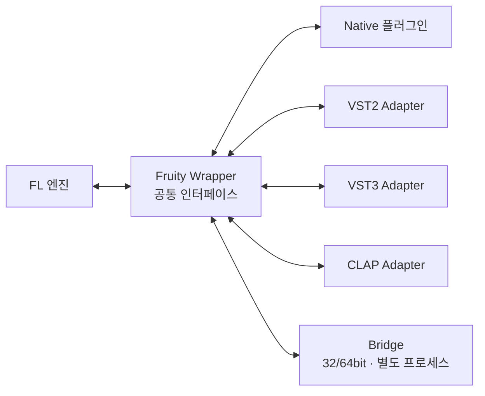
- 엔진은 모든 플러그인을 **하나의 공통 인터페이스**로 다룬다 (Adapter 패턴).
- Wrapper가 공통으로 맡는 일: 파라미터 목록 노출(오토메이션 ID 생성), 프리셋 저장, MIDI 포트 매핑, 처리 옵션(멀티코어, 버퍼 크기 강제, 스마트 비활성화), 브리징.
- **Smart Disable:** 입력이 무음인 동안 플러그인 처리를 멈춰 CPU를 아낀다 [확인]

### 10.3 Patcher: 플러그인 안의 작은 그래프
- 여러 플러그인과 연결선을 그래프로 묶어 **하나의 플러그인처럼** 저장하고 불러온다.
- 오디오, MIDI(노트), 컨트롤 연결을 모두 그래프 위에서 만든다.
- → 사용자 수준에서 **복합 신스나 이펙트 체인을 재사용 단위로** 만드는 도구다. 설계상 Mixer 그래프의 축소판이다.

### 10.4 네이티브 플러그인 전략
- 플러그인 묶음(에디션)이 **매출과 업그레이드를 이끄는 장치**다 (15장 참고).
- 네이티브 플러그인은 Slide 노트, Mod X/Y, Note color 같은 **FL 전용 노트 속성을 완전히 지원**한다. 외부 VST는 일부만 지원한다. → 생태계 안에 머물게 만드는 효과(lock-in)가 있다.

### 10.5 기획 의도 `P7` `P2`
| 관점 | 내용 |
|---|---|
| 해결하려는 문제 | 플러그인 규격(VST2/3, CLAP, AU)마다 다른 방식으로 동작하면 사용자가 규격 차이를 신경 써야 한다 |
| 의도한 경험 | 어떤 플러그인이든 **똑같이 끌어다 놓고, 똑같이 자동화하고, 똑같이 프리셋을 저장**한다 |
| 구현 장치 | Fruity Wrapper(공통 인터페이스), 공통 프리셋 형식(.fst), Patcher |
| 감수한 비용 | Wrapper 계층 때문에 플러그인 고유의 기능(예: VST3 노트 표현)을 FL 노트 속성과 맞추는 데 한계가 있다 |

- **네이티브 플러그인을 계속 만드는 이유:** ① 에디션 업셀 상품, ② FL 전용 노트 속성을 100% 활용하는 "정답 사례" 제공, ③ 외부 플러그인 없이도 곡을 끝낼 수 있게 하여 입문자의 추가 지출 부담을 줄인다.

---

## 11. 오디오 엔진 & 렌더링 파이프라인

### 11.1 블록 처리 루프 (추정) [추정]
오디오 드라이버(ASIO / FL Studio ASIO / WASAPI / CoreAudio)가 콜백을 부를 때마다 아래를 실행한다.

```text
on_audio_callback(buffer_frames):
    t0 = song_position_ticks
    t1 = t0 + frames_to_ticks(buffer_frames, tempo_map)

    # 1) 이벤트 수집
    events = playlist.collect(t0, t1)          # 노트·오토메이션·클립 시작
    events += remote_control.poll()            # MIDI 입력, 컨트롤러
    sort(events, by=sample_offset)

    # 2) 소스 처리
    for channel in active_channels:
        channel.process(events[channel], buffer_frames)   # 샘플 단위 정확한 오프셋
        mixer[channel.mixerTarget].input += channel.out

    # 3) Mixer 그래프 (위상 정렬 + 병렬)
    for level in mixer.topo_levels:
        parallel_for(track in level): track.process()

    # 4) 출력
    driver.output = mixer.master.out
    song_position_ticks = t1
```

- **이벤트 정밀도:** 버퍼 안에서도 샘플 오프셋을 계산해 노트 타이밍을 맞춘다 (sample-accurate).
- **버퍼 크기 ↔ 지연:** ASIO 버퍼가 작을수록 지연은 줄고 CPU 부담은 커진다. 이런 이유로 FL Studio는 자체 **FL Studio ASIO** 드라이버를 함께 제공한다 [확인]

### 11.2 렌더링 (Export)
- 실시간 콜백 대신 **오프라인 루프**를 실행한다. 버퍼 크기를 키우고 더 높은 품질의 보간(sinc), 리샘플링, 디더링 옵션을 쓴다 [확인]
- **Split mixer tracks:** Insert마다 따로 WAV 스템을 뽑는다.
- **Tail 처리:** 리버브 꼬리 등을 위해 "Leave remainder / Wrap remainder" 옵션을 둔다.

### 11.3 오디오 클립 처리
- **Stretch 모드:** Resample(피치 같이 변함) / élastique Pro 기반 time-stretch / Slice 기반(Slicex) 등 [확인]
- **Auto-fit to tempo:** 샘플의 BPM을 읽어 프로젝트 템포에 맞춘다.
- **Stem Separation (FL 2025):** AI로 보컬, 드럼, 베이스, 기타 악기를 분리한다 [확인]

### 11.4 기획 의도 `P1`
| 관점 | 내용 |
|---|---|
| 해결하려는 문제 | 입문자의 PC에는 전용 오디오 인터페이스가 없어 내장 사운드카드의 큰 지연 때문에 연주가 어렵다 |
| 의도한 경험 | 오디오 인터페이스 없이도 노트를 찍는 즉시 소리가 난다 |
| 구현 장치 | 자체 FL Studio ASIO 드라이버, Smart Disable, 멀티코어 Mixer 처리 |
| 감수한 비용 | 드라이버와 버퍼 설정 옵션이 많아 문제가 생겼을 때 원인을 찾기 어렵다 |

---

## 12. 프로젝트 파일 (.flp) 구조

오픈소스 파서(PyFLP 등)로 공개적으로 분석된 사실을 바탕으로 정리한다 [확인]

### 12.1 청크 구조
```
┌────────────────────────────────────────┐
│ "FLhd" (4B) | header size=6 (4B)      │
│   format (2B) | n_channels (2B) | PPQ (2B)
├────────────────────────────────────────┤
│ "FLdt" (4B) | data size (4B)          │
│   Event 0                              │
│   Event 1                              │
│   ...                                  │
└────────────────────────────────────────┘
```
- 겉모양은 **MIDI 파일(MThd/MTrk)과 아주 비슷하다.** 출발점이 MIDI 시퀀서였던 흔적이다.

### 12.2 이벤트 인코딩 (TLV 변형)
| 이벤트 ID 범위 | 값 크기 | 예시 |
|---|---|---|
| 0 ~ 63 | 1 byte | 채널 활성 여부, 루프 켜짐 |
| 64 ~ 127 | 2 byte (word) | 채널 볼륨, 피치 |
| 128 ~ 191 | 4 byte (dword) | 색상, 템포(×1000) |
| 192 ~ 255 | **가변 길이** (7bit varint 길이 + 데이터) | 이름 문자열, 노트 배열, 플러그인 상태, Playlist 아이템 |

### 12.3 핵심 설계: **상태를 이벤트의 흐름으로 저장**
- 파일은 트리 구조가 아니라 **"현재 선택된 대상"을 바꿔 가며 속성을 설정하는 명령 스트림**이다.
  - 예: `ChannelNew(3)` → `ChannelName("Kick")` → `ChannelVolume(...)` → `PatternNew(1)` → `PatternNotes(...)`.
- 장점
  - **하위 호환:** 처음 보는 ID는 크기 규칙에 따라 건너뛰면 되므로 구버전도 신버전 파일을 부분적으로 읽을 수 있다.
  - **확장성:** 새 기능은 새 ID를 추가하는 것으로 끝난다.
- 단점: 순서에 의존하고 구조가 드러나지 않아 외부 도구가 다루기 어렵다.
- 플러그인 상태는 플러그인이 직접 직렬화한 데이터 덩어리(VST chunk 등)를 그대로 넣는다.

### 12.4 기획 의도 `P7`
| 관점 | 내용 |
|---|---|
| 해결하려는 문제 | 평생 무료 업데이트를 약속했으므로, 20년 전 프로젝트도 최신 버전에서 열려야 한다 |
| 의도한 경험 | 버전을 올려도 옛 곡을 그대로 연다. 업데이트를 두려워하지 않는다 |
| 구현 장치 | 크기 규칙이 ID에 들어 있는 이벤트 형식 → 모르는 이벤트는 건너뛴다 |
| 감수한 비용 | 구조가 드러나지 않아 외부 도구(협업 서비스, 버전 관리, 다른 DAW)와 연동하기 어렵다 → 공유를 위해 별도 형식들이 필요해진다 (13장) |

---

## 13. 악보·데이터 공유 시스템

> 여기서 "악보"는 FL Studio에서 말하는 **Score**, 즉 **소리 없이 노트만 담은 데이터**를 뜻한다. FL Studio에는 오선 악보(Notation) 화면이 없으므로, 오선 악보 공유는 13.6에서 따로 다룬다.

### 13.1 공유 단위의 계층
FL Studio의 공유 형식은 **"무엇을 담는가"**에 따라 층을 이룬다. 위로 갈수록 담는 범위가 넓고, 받는 쪽에 필요한 것(같은 플러그인, 같은 샘플)도 많아진다.

| 단위 | 형식 | 담는 것 | 담지 않는 것 | 주 용도 |
|---|---|---|---|---|
| **노트 복사** | 클립보드 | 선택한 노트와 속성 | 악기 | 프로젝트끼리 멜로디 옮기기 [추정] |
| **Score** | `.fsc` [확인] | 피아노 롤 노트 (FL 전용 속성 포함) | 악기, 소리 | 멜로디·코드 진행을 다른 악기에 재사용 |
| **MIDI** | `.mid` [확인] | 노트, 템포, 트랙 구분 | FL 전용 속성 일부, 악기 | 다른 DAW·악보 프로그램과 교환 |
| **Channel / Plugin Preset** | `.fst` [확인] | 악기 설정 (플러그인 상태, 채널 설정) | 노트 | 사운드 공유 |
| **Mixer Track State** | `.fst` [확인] | Insert의 이펙트 체인과 설정 | 노트, 악기 | 보컬 체인 등 처리 과정 공유 |
| **Project Bones** | 폴더 [확인] | 채널별 Score + 샘플 + 프리셋을 일괄 내보내기 | 편곡(Playlist), Mixer [추정] | 프로젝트의 재료 추출 |
| **Project** | `.flp` | 전체 상태 | 샘플·외부 플러그인 본체 | 같은 환경 사용자와 공유 |
| **Zipped Loop Package** | `.zip` [확인] | `.flp` + 사용한 샘플 | 외부 플러그인 본체 | 다른 PC로 프로젝트 이동, 협업 |
| **오디오 / 스템** | `.wav` `.mp3` 등 [확인] | 최종 소리 (Insert별 분리 가능) | 편집 가능한 데이터 | 믹싱 엔지니어, 배포 |

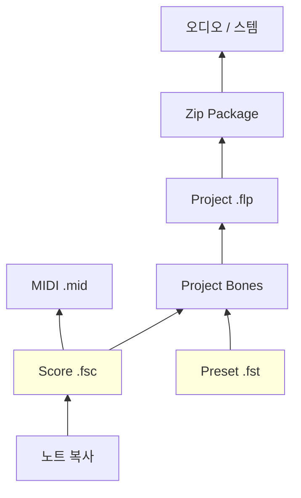
→ **노트(Score)와 소리(Preset)를 따로 저장하는 구조**가 핵심이다. 이것은 Channel Rack(소리)과 Pattern(노트)을 나눈 2.3의 분리 원칙이 공유 형식에서도 그대로 나타난 것이다.

### 13.2 Score 파일 (.fsc)
- 피아노 롤 메뉴에서 **Save score as / Load score**로 저장하고 불러온다 [확인]
- 담는 것: 노트 위치, 길이, 음높이, 세기와 FL 전용 노트 속성(Slide, Mod X/Y, 색상 등) [추정]
- 담지 않는 것: 어떤 악기로 연주할지. → 불러올 때 **지금 선택한 채널**에 들어간다.
- Browser의 Scores 폴더에서 끌어다 놓아 쓸 수도 있다 [추정]
- **기획 의도:** 코드 진행이나 리프를 "어떤 악기로든" 다시 쓰게 한다. 예를 들어 피아노로 만든 코드 진행을 패드 신스에 그대로 옮긴다 (P2).
- .fsc 파일의 바이너리 구조(추정)와 스크립트로 Score를 만드는 방법은 [스크립팅과 LLM 연동](FL_Studio_스크립팅_LLM연동.md) 문서 1장에 정리했다.

### 13.3 MIDI 내보내기·가져오기 — 무엇이 남고 무엇이 사라지는가
| FL 노트 속성 | MIDI로 나갈 때 | 비고 |
|---|---|---|
| 위치·길이·음높이 | 유지: 그대로 | tick 해상도는 PPQ에 맞추어 변환 |
| Velocity | 유지: Note On velocity | |
| Release velocity | 유지: Note Off velocity | 받는 쪽이 무시하는 경우 많음 |
| Color | 유지: **MIDI 채널**로 변환 [추정] | 5.2 색상 = MIDI 채널 설계 덕분 |
| Fine pitch | 일부 손실: 피치 벤드로 바뀌거나 사라짐 [추정] | |
| Pan, Mod X/Y | 일부 손실: 대부분 사라짐 [추정] | MIDI 노트 단위 속성이 아님 |
| Slide / Porta | 손실: 사라짐 [추정] | FL 전용 개념 |
| 패턴 구조 | 손실: 사라짐 | 평평한 트랙 목록이 됨 |
| 오토메이션 클립 | 일부 손실: 일부만 CC로 | |

- **가져오기:** MIDI 파일을 열면 트랙마다 채널을 만들고 노트를 패턴에 넣는다. 옵션으로 트랙별 패턴 분리 여부를 고른다 [확인]
- **분석:** FL Studio의 표현력(노트에 붙은 속성)이 강할수록 MIDI로 나갈 때 잃는 정보도 많아진다. **"내부 표현력 vs 외부 호환성"**의 트레이드오프다.

### 13.4 Score Logger — 놓친 연주 되살리기
- FL Studio는 녹음 버튼을 누르지 않아도 **최근 MIDI 입력을 계속 기록**한다 [확인]
- Tools 메뉴의 **Dump score log to selected pattern**으로 방금 친 연주를 패턴에 넣는다 [확인]
- **기획 의도:** "방금 친 게 좋았는데 녹음을 안 했다"는 순간을 없앤다. 녹음 준비 단계를 없애 P1을 연주 입력까지 확장했다.

### 13.5 프로젝트 공유와 협업
| 상황 | 방법 | 한계 |
|---|---|---|
| 같은 FL 사용자에게 곡 전달 | Zipped Loop Package | 외부 VST가 상대에게 없으면 그 채널은 소리가 나지 않는다 |
| 다른 DAW 사용자와 협업 | 스템(Split mixer tracks) + MIDI | 편집 가능한 구조가 사라진다 |
| 재료 넘기기 (리믹스 등) | Project Bones, 스템 | 편곡은 다시 해야 한다 |
| 모바일 ↔ PC | FL Studio Mobile 프로젝트(.flm) 가져오기 [확인] | 모바일 → PC 한 방향 위주 |
| 사운드·플러그인 공유 | FL Cloud (샘플, 플러그인, 마스터링, 배포) [확인] | 실시간 공동 편집 기능은 확인되지 않음 [추정] |

- **실시간 공동 편집이 어려운 구조적 이유:** `.flp`가 "현재 대상을 바꿔 가며 설정하는 명령 스트림"(12.3)이라 부분 단위로 합치거나 충돌을 해결하기 어렵다. 또 노트가 (채널, 패턴) 쌍에 있어 두 사람이 같은 채널의 다른 패턴을 고쳐도 의존 관계가 생긴다.

### 13.6 오선 악보 공유 (Notation)
- FL Studio에는 **오선 악보 화면과 악보 인쇄 기능이 없다.**
- 연주자에게 악보를 줘야 할 때: FL에서 **MIDI로 내보내기 → MuseScore, Sibelius, Dorico 등에서 열기 → 다듬기**.
- **기획 의도로 본 해석:** 주 타깃(비트메이커, 전자음악 프로듀서)은 오선 악보를 거의 쓰지 않는다. 피아노 롤을 "타깃 사용자의 악보"로 삼고, 오선 악보에 들일 개발 비용을 피아노 롤 도구에 쓴 선택이다.
- **비용:** 실제 연주자와 함께하는 작업(세션 녹음, 편곡 의뢰, 교육)에서는 외부 프로그램이 필수다. 중급 이상 사용자가 다른 DAW로 옮기는 이유 중 하나가 된다.

### 13.7 기획 의도 `P2` `P1` `P7`
| 관점 | 내용 |
|---|---|
| 해결하려는 문제 | 프로젝트 전체를 넘기면 받는 사람에게 같은 플러그인과 샘플이 있어야 한다. 필요한 부분만 꺼내 쓰고 싶다 |
| 의도한 경험 | 노트만, 소리만, 처리 과정만 **필요한 층만 골라 공유**한다 |
| 구현 장치 | Score(.fsc)·Preset(.fst)·Mixer State(.fst)로 층별 형식 분리, Zip 패키지, 스템 렌더 |
| 감수한 비용 | 형식이 많아 입문자가 무엇을 써야 할지 헷갈린다. FL 전용 속성은 외부 형식으로 나가면 사라진다. 오선 악보와 실시간 협업은 지원하지 않는다 |

### 13.8 공유 시스템 개선 제안
1. **MIDI 내보내기 손실 미리보기:** 내보내기 전에 "Slide 노트 12개, Mod X 이벤트 40개가 사라집니다"처럼 잃는 정보를 알려 주고, Slide를 피치 벤드로 바꾸는 등의 변환 옵션을 준다.
2. **MusicXML 내보내기:** 오선 악보 화면을 만들지 않고도 악보 프로그램과 바로 이어 주는 낮은 비용의 해결책.
3. **패턴 단위 공유:** 현재 Score는 채널 하나의 노트만 담는다. **패턴 전체(여러 채널의 노트 + 채널 이름)**를 담는 형식이 있으면 "드럼 루프 하나"를 그대로 주고받을 수 있다.
4. **누락 플러그인 대체:** Zip 패키지를 열 때 없는 플러그인 채널을 렌더된 오디오로 대신 재생하는 "프리즈 포함 내보내기".

---

## 14. UX 시스템

### 14.1 윈도우 모델
- **MDI 방식 + 떼어낼 수 있는 창:** Channel Rack, Piano Roll, Playlist, Mixer, Browser가 모두 독립된 창이다. 여러 모니터로 떼어낼 수 있다.
- 단축키 F5~F9로 핵심 창을 바로 연다 (F5 Playlist, F6 Channel Rack, F7 Piano Roll, F9 Mixer) [확인]

### 14.2 "모든 것은 끌어다 놓기"
- 브라우저 → Channel Rack (샘플 채널 생성) / Playlist (오디오 클립) / Mixer 슬롯 (이펙트) / 플러그인 (프리셋).
- 파라미터 → 오른쪽 클릭 → 오토메이션 생성. **기능을 찾아다니는 대신 대상에서 바로 해결**하는 일관된 상호작용 원칙이다.

### 14.3 피드백 장치
- **Hint Bar:** 마우스를 올린 요소의 이름과 값, 단축키를 상단에 보여준다. 툴팁 대신 쓰는 상시 도움말이다.
- 미리듣기: 브라우저 샘플 클릭 시 재생, 스텝 클릭 시 해당 소리 재생.
- 템포에 맞춘 미리듣기, Note preview.

### 14.4 진입 장벽 완화 장치 (FL 2024~2025)
- **Loop Starter**, **FL Cloud 샘플·사운드**, **Gopher AI 도우미** (기능을 묻고 답하는 챗봇) [확인]
- 무료 체험판은 기능 제한이 거의 없고 **저장한 프로젝트를 다시 열 수 없다는 점**만 다르다 [확인] → "만들어 보고 싶다"를 "구매"로 바꾸는 깔때기.

### 14.5 기획 의도 `P6` `P1`
| 관점 | 내용 |
|---|---|
| 해결하려는 문제 | 기능이 많은 DAW는 "이 기능이 어느 메뉴에 있는지"를 찾는 데 시간을 쓴다 |
| 의도한 경험 | 대상에서 바로 해결하고, 모르는 것은 Hint Bar가 늘 알려 준다 |
| 구현 장치 | 오른쪽 클릭 메뉴 통일, 드래그 앤 드롭, Hint Bar, 떼어낼 수 있는 창 |
| 감수한 비용 | 창이 서로 겹쳐 화면이 어지러워지기 쉽다. 기능이 메뉴 깊숙이 숨어 있어 "있는 줄 몰랐던 기능"이 많다 |

---

## 15. 비즈니스 모델과 제품 전략

| 요소 | 내용 | 기획 의도 |
|---|---|---|
| **평생 무료 업데이트** (Lifetime Free Updates) [확인] | 한 번 사면 이후 모든 메이저 버전을 무료로 받는다 | 높은 충성도, 입소문, 업그레이드 피로감 제거 |
| **에디션 단계** | Fruity → Producer → Signature → All Plugins | 낮은 진입 가격 → 플러그인 묶음으로 단계적 업셀 |
| **Fruity 에디션 제한** | Playlist에 오디오 클립 사용 불가 등 | 기능 장벽을 업그레이드 동기로 사용 |
| **FL Cloud** (구독) | 샘플, 마스터링, 배포, 플러그인 | 일회성 판매 모델의 약점(반복 매출 부족) 보완 |
| **체험판** | 저장 파일 재오픈 제한 | 학습은 무료로, 완성은 유료로 |

**분석:** 평생 무료 업데이트는 매출 면에서 불리해 보인다. 하지만 ① 신규 사용자 유입(입문자 → 유튜브 튜토리얼 → 구매), ② 에디션 업셀, ③ 구독(FL Cloud)이라는 세 갈래 매출 구조로 이를 보완한다.

---

## 16. 경쟁 DAW 비교

| 항목 | FL Studio | Ableton Live | Logic Pro | Cubase |
|---|---|---|---|---|
| 시퀀스 기본 단위 | **Pattern** (채널 전체 노트 묶음) | Clip (트랙 하나) | Region (트랙 하나) | Part/Event (트랙 하나) |
| 트랙 개념 | Playlist 트랙에 종류가 없음 | 트랙 = 악기 + 믹서 | 트랙 = 악기 + 채널 스트립 | 트랙 = 악기 + 채널 |
| 악기 위치 | Channel Rack (따로 분리) | 트랙 안 | 트랙 안 | 트랙 안 |
| 믹서 라우팅 | 자유 그래프, 모든 트랙 동일 종류 | Return 트랙 별도 | Aux / Bus 별도 | FX / Group 별도 |
| 강점 | 피아노 롤, 패턴 기반 비트메이킹 속도 | 라이브 연주, 워핑 | 녹음, 기본 악기·루프 | 녹음, 편집, 스코어 |
| 약점 | 큰 프로젝트 정리, 녹음 작업 흐름 | 선형 편곡 편집 | macOS 전용 | 학습 곡선 |
| 가격 정책 | **평생 무료 업데이트** | 메이저 버전 유료 업그레이드 | 한 번 구매 | 메이저 버전 유료 업그레이드 |

---

## 17. 설계 평가와 개선 제안

### 17.1 강점
1. **입력부터 소리가 나기까지의 시간이 가장 짧다:** 스텝 시퀀서 + PAT 모드 + 미리듣기의 조합.
2. **피아노 롤 표현력:** 노트에 담긴 속성(Mod X/Y, Slide, Color→MIDI 채널)과 노트 변환 도구들.
3. **자유 구조:** 종류 없는 Playlist 트랙과 모든 트랙이 같은 종류인 Mixer. 규칙을 거의 강요하지 않는다.
4. **확장 가능한 파일 형식:** 이벤트 스트림 구조로 20년 넘게 하위 호환을 유지하고 있다.
5. **비즈니스 모델:** 평생 업데이트 → 커뮤니티 확장 → 튜토리얼 생태계 → 신규 유입이라는 선순환.

### 17.2 구조적 약점
| 문제 | 원인 | 사용자 증상 |
|---|---|---|
| **세 군데로 흩어진 정보** | 악기(Channel Rack), 노트(Pattern), 배치(Playlist), 믹서(Insert)가 따로따로다 | "이 소리가 Mixer 몇 번이지?", "이 클립은 무슨 패턴이지?" |
| 연결 안 된 채널 | `mixerTarget=0`이 기본값이던 역사 | 이펙트 없이 Master로 직행 |
| 오토메이션 방식 세 갈래 | 클립 / 이벤트 / 링크가 공존 | 값이 어디서 바뀌는지 추적하기 어렵다 |
| 패턴 남발 | Make Unique, Split by channel | Pattern 1~200 목록 관리 부담 |
| 녹음 작업 흐름 | 오디오 녹음이 Mixer 입력 → Playlist 순서라 직관적이지 않다 | 보컬 녹음 사용자의 이탈 |

### 17.3 개선 제안
> 패턴 시스템과 공유 시스템의 세부 개선안은 각각 6.12와 13.8에 정리했다. 여기에는 시스템 전체에 걸친 제안만 둔다.

1. **연결 시각화 (Signal Inspector)**
   - 채널, 패턴, 클립, Mixer Insert 중 하나를 선택하면 관련된 나머지 요소를 모든 창에서 함께 강조한다.
   - 데이터 모델은 그대로 두고 **뷰 수준의 참조 그래프**만 추가하므로 비용이 적다.
2. **파라미터 출처 표시**
   - 오토메이션이 걸린 노브에 출처 배지(Clip / Event / Link)를 표시하고, 누르면 출처로 이동한다.
3. **Track Mode 완성**
   - Playlist 트랙 ↔ Channel ↔ Mixer Insert를 1:1:1로 묶는 **선택형 "트랙 모드" 프로젝트 템플릿**을 제공한다.
   - 기존 자유 구조는 그대로 두고, 녹음과 믹싱을 주로 하는 사용자에게 다른 DAW처럼 익숙한 작업 흐름을 제공한다.
4. **패턴 사용처 표시**
   - 패턴 목록에 Playlist 사용 횟수와 위치를 보여주고, 쓰지 않는 패턴을 정리하는 기능을 추가한다.

---

## 부록 A. 핵심 데이터 관계도 (ERD 요약)

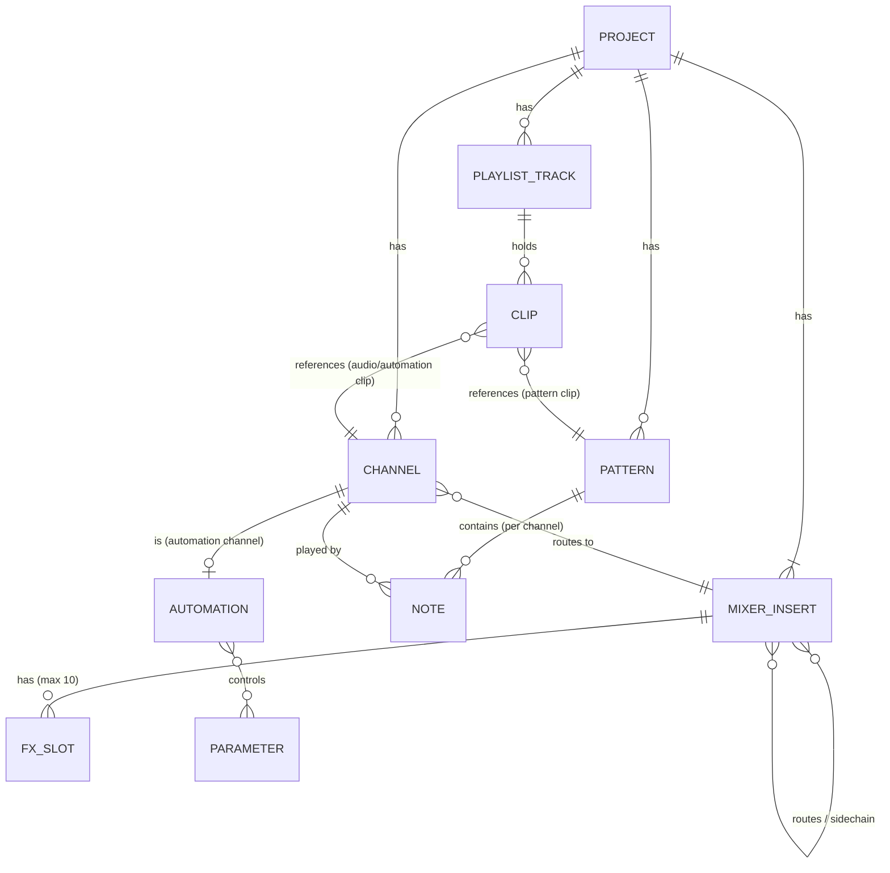

## 부록 B. 용어 정리
| 용어 | 뜻 |
|---|---|
| Channel | Channel Rack에 등록된 소리 원본 (악기, 샘플, 오토메이션 등) |
| Pattern | 채널별 노트와 이벤트를 묶은 시퀀스 단위 |
| Playlist | 곡 타임라인. 클립을 배치하는 곳 |
| Insert | Mixer 트랙 하나 |
| Generator | 소리를 만드는 플러그인 (악기) |
| PDC | 플러그인 지연 보정 |
| PPQ | 4분음표당 tick 수 |
| Make Unique | 참조 중인 패턴이나 클립을 독립된 복제본으로 바꾸는 기능 |

---

> **분석 한계:** [추정] 표시는 사용자가 볼 수 있는 동작을 바탕으로 한 추정이며 Image-Line의 실제 소스 코드와 다를 수 있다. 수치(Insert 125개, 슬롯 10개, Playlist 트랙 500개, PPQ 범위 등)는 공식 매뉴얼 기준이며 버전에 따라 달라질 수 있다.
