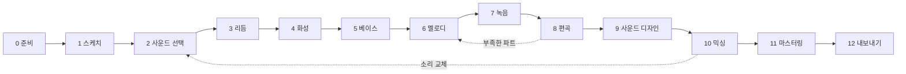

# FL Studio 작곡 파이프라인별 기능 활용 분석

> 대상: FL Studio 2024~2025 버전 기준
> 목적: 곡 하나가 만들어지는 과정을 단계별로 나누고, 각 단계에서 FL Studio의 어떤 기능을 어떻게 쓰는지, 그 기능이 어떤 시스템 원리 위에서 동작하는지 분석한다.
> 표기: `[확인]` 공식 문서나 공개된 사실 / `[추정]` 동작 관찰을 바탕으로 한 추정 / `P1`~`P7`은 [역기획서](FL_Studio_역기획서.md) 2.4절의 상위 기획 원칙
> 관련 문서: [역기획서](FL_Studio_역기획서.md) · [스크립팅과 LLM 연동](FL_Studio_스크립팅_LLM연동.md) · [문서 색인](README.md)

---

## 목차
1. [작곡 파이프라인 개요](#1-작곡-파이프라인-개요)
2. [단계 0: 작업 환경 준비](#2-단계-0-작업-환경-준비)
3. [단계 1: 아이디어 스케치](#3-단계-1-아이디어-스케치)
4. [단계 2: 사운드 선택](#4-단계-2-사운드-선택)
5. [단계 3: 리듬 (드럼)](#5-단계-3-리듬-드럼)
6. [단계 4: 화성 (코드 진행)](#6-단계-4-화성-코드-진행)
7. [단계 5: 베이스](#7-단계-5-베이스)
8. [단계 6: 멜로디와 탑라인](#8-단계-6-멜로디와-탑라인)
9. [단계 7: 녹음 (보컬, 악기)](#9-단계-7-녹음-보컬-악기)
10. [단계 8: 편곡](#10-단계-8-편곡)
11. [단계 9: 사운드 디자인과 전환 효과](#11-단계-9-사운드-디자인과-전환-효과)
12. [단계 10: 믹싱](#12-단계-10-믹싱)
13. [단계 11: 마스터링](#13-단계-11-마스터링)
14. [단계 12: 내보내기와 공유](#14-단계-12-내보내기와-공유)
15. [장르별 파이프라인 예시](#15-장르별-파이프라인-예시)
16. [파이프라인 관점의 기획 분석](#16-파이프라인-관점의-기획-분석)
17. [단계별 자동화와 LLM 활용 지도](#17-단계별-자동화와-llm-활용-지도)

---

## 1. 작곡 파이프라인 개요

### 1.1 전체 흐름

- 실제 작업은 일직선이 아니다. 특히 **3~6단계(루프 만들기)는 하나의 패턴 안에서 계속 오가며** 진행된다.
- 단계 순서는 장르와 사람마다 다르다. 15장에서 장르별 차이를 다룬다.

### 1.2 두 가지 출발 방식
| 방식 | 흐름 | FL Studio와의 궁합 |
|---|---|---|
| **루프 우선** (Loop-first) | 4~8마디 루프를 완성 → 루프를 늘리고 빼서 곡 구조 만들기 | 매우 좋음. 패턴, PAT 모드, 스텝 시퀀서가 이 방식을 위해 설계됨 |
| **구조 우선** (Song-first) | 곡 구조(절, 후렴)를 먼저 정함 → 처음부터 끝까지 채워 나감 | 보통. 타임 마커와 Playlist로 가능하지만 패턴 수 관리 부담이 커짐 |

FL Studio의 기본 설계는 **루프 우선**이다 (역기획서 6.2절, 드럼 머신 기원).

### 1.3 단계와 기능 매트릭스
`●` 핵심 기능, `○` 보조 기능

| 기능 | 0 준비 | 1 스케치 | 2 사운드 | 3 리듬 | 4 화성 | 5 베이스 | 6 멜로디 | 7 녹음 | 8 편곡 | 9 디자인 | 10 믹싱 | 11 마스터 | 12 내보내기 |
|---|---|---|---|---|---|---|---|---|---|---|---|---|---|
| Browser | ● | ○ | ● | ○ | | ○ | | | | ○ | | | |
| Channel Rack | ● | ○ | ● | ● | ○ | ○ | ○ | | | | ○ | | |
| Step Sequencer | | ● | | ● | | ○ | | | | | | | |
| Piano Roll | | ● | | ○ | ● | ● | ● | | | ○ | | | |
| Score Logger | | ● | | | ○ | | ● | | | | | | |
| Pattern | | ● | | ● | ● | ● | ● | | ● | | | | |
| Playlist | | | | | | | | ● | ● | ● | | | |
| Mixer | ● | | | | | ○ | | ● | | ○ | ● | ● | ● |
| Automation Clip | | | | | | | | | ● | ● | ○ | | |
| Edison | | ○ | ○ | | | | | ● | | ● | | | |
| Patcher | ○ | | ○ | | | | | | | ● | ○ | | |
| Render / Export | | | | | | | | | ○ | ● | | | ● |

---

## 2. 단계 0: 작업 환경 준비

**목표:** 프로그램을 열자마자 바로 만들 수 있는 상태 (P1).

| 기능 | 활용법 |
|---|---|
| **템플릿** | 자주 쓰는 드럼 키트, 808, 신스, 믹서 버스, 리버브·딜레이 리턴 트랙을 미리 구성한 프로젝트를 템플릿으로 저장한다 `[확인]` |
| **Mixer 자동 연결** | 새 채널을 빈 믹서 트랙에 자동 연결하는 옵션을 켠다. 채널이 Master로 바로 가는 함정(역기획서 8.4절)을 막는다 |
| **오디오 설정** | 전용 인터페이스가 없으면 FL Studio ASIO를 쓰고, 작곡 단계에서는 버퍼를 작게, 믹싱 단계에서는 크게 둔다 |
| **Browser 정리** | 자주 쓰는 샘플 폴더를 Browser에 추가하고, 플러그인 즐겨찾기(Plugin Database)를 만든다 |
| **채널 이름 규칙** | 채널 순서와 이름을 템플릿에서 고정한다. 나중에 스크립트나 LLM으로 제어할 때도 기준이 된다 (스크립팅 문서 5장) |

**시스템 원리:** 템플릿은 .flp 그 자체이므로, 채널, 패턴, 믹서 라우팅, 플러그인 상태가 모두 그대로 복원된다. 준비 비용을 한 번만 치르는 구조 (P2).

**흔한 실수:** 템플릿 없이 매번 빈 프로젝트에서 시작해 믹서 연결을 빠뜨린다.

---

## 3. 단계 1: 아이디어 스케치

**목표:** 떠오른 리듬이나 멜로디를 잃기 전에 붙잡는다.

| 기능 | 활용법 |
|---|---|
| **Score Logger** | 녹음 버튼을 누르지 않고 건반을 쳐도 기록된다. 좋았던 연주는 Tools > Dump score log to selected pattern으로 패턴에 넣는다 `[확인]` |
| **컴퓨터 키보드 입력** | MIDI 건반이 없으면 컴퓨터 키보드를 피아노 건반으로 쓰는 옵션을 켠다 `[확인]` |
| **PAT 모드 + 새 패턴** | 아이디어마다 빈 패턴을 하나씩 쓴다. 패턴 이름에 "idea_코드1" 같은 이름을 붙여 둔다 |
| **Loop Starter** | 장르를 고르면 시작용 루프를 만들어 주는 기능. 빈 화면에서 막힐 때 출발점으로 쓴다 `[확인]` |
| **Edison** | 허밍이나 외부 소리를 바로 녹음해 샘플로 쓴다 |

**시스템 원리:** Score Logger는 FL이 MIDI 입력을 항상 버퍼에 쌓아 두는 구조로 동작한다. 녹음 준비 단계를 없애 P1을 연주 입력까지 확장한 장치다.

**흔한 실수:** 한 패턴에 여러 아이디어를 덮어써서 앞의 아이디어를 잃는다.

---

## 4. 단계 2: 사운드 선택

**목표:** 곡의 성격을 정하는 키트(드럼, 베이스, 화성 악기, 리드)를 고른다.

| 기능 | 활용법 |
|---|---|
| **Browser 미리듣기** | 샘플을 클릭하면 바로 들린다. 방향키로 넘기며 빠르게 비교한다 |
| **Channel Rack 끌어다 놓기** | Browser의 샘플을 Channel Rack의 기존 채널 위에 놓으면 샘플만 교체된다. 노트는 그대로라 **같은 리듬에 다른 소리를 바로 비교**할 수 있다 |
| **FPC** | 드럼 패드 악기. 키트 전체를 하나의 채널에 담고, 패드마다 다른 샘플을 넣는다 |
| **Sampler 채널 설정** | 샘플의 음높이, 길이, 엔벨로프, 리버스 등을 채널 안에서 바로 조정한다 |
| **신스 프리셋** | FLEX, Sytrus, Harmor 등의 프리셋을 브라우징한다. FLEX는 프리셋 팩 중심이라 고르기 빠르다 |
| **Slicex** | 루프 샘플을 조각내 건반에 배치한다. 샘플 기반 장르에서 리듬을 재구성할 때 쓴다 |

**시스템 원리:** 소리(Channel)와 노트(Pattern)가 분리되어 있으므로 **노트를 건드리지 않고 소리만 교체**할 수 있다 (역기획서 2.3절). 이 분리가 사운드 선택 단계를 빠르게 만든다.

**흔한 실수:** 사운드 선택에 너무 오래 머문다. 루프가 어느 정도 생긴 뒤 다시 바꾸는 편이 판단이 쉽다.

---

## 5. 단계 3: 리듬 (드럼)

**목표:** 곡의 그루브를 정하는 드럼 루프를 만든다.

| 기능 | 활용법 |
|---|---|
| **Step Sequencer** | 킥, 스네어, 햇을 클릭으로 찍는다. 가장 빠른 드럼 입력 |
| **Graph Editor** | 스텝마다 세기와 팬을 조정한다. 하이햇의 강약을 다르게 주면 기계적인 느낌이 줄어든다 |
| **Swing** | Channel Rack의 Swing 노브로 짝수 스텝을 뒤로 민다. 하이햇만 스윙을 받게 하고 킥은 정박에 둔다 |
| **Channel time offset** | 채널 전체를 미세하게 앞뒤로 민다. 스네어를 살짝 늦춰 느긋한 느낌을 만든다 |
| **Piano Roll Chop** | 하이햇 롤(트랩의 빠른 연타)을 만들 때 긴 노트를 잘게 자른다 `[확인]` |
| **Piano Roll Flam / Strum** | 노트를 미세하게 흩어 사람이 친 느낌을 낸다 |
| **Ghost Notes** | 피아노 롤에서 킥 노트를 보며 다른 타악기 위치를 맞춘다 |

**시스템 원리:**
- 스텝은 피아노 롤 노트를 보여주는 다른 화면이다 (역기획서 4.4절). 그래서 **스텝으로 찍고, 피아노 롤에서 다듬는** 흐름에 데이터 변환이 필요 없다 (P3).
- 드럼 패턴은 **여러 채널을 하나의 패턴에 담는 방식**이 유리하다. 드럼 루프 전체를 블록 하나로 배치할 수 있기 때문이다.

**흔한 실수:** 드럼 변주(필인)를 원래 패턴에 직접 고쳐서 모든 반복 구간이 함께 바뀐다. 필인은 Make Unique로 따로 만든다 (역기획서 6.5절).

---

## 6. 단계 4: 화성 (코드 진행)

**목표:** 곡의 분위기를 정하는 코드 진행을 만든다.

| 기능 | 활용법 |
|---|---|
| **Scale Highlighting** | 곡의 키와 스케일을 정하면 피아노 롤에 해당 음만 강조된다. 이론을 몰라도 틀린 음을 피한다 `[확인]` |
| **Chord Stamp** | 근음 하나를 찍으면 선택한 코드 구성음이 한 번에 들어간다 `[확인]` |
| **Riff Machine** | 코드 진행과 리듬 패턴을 자동 생성한다. 출발점으로 쓰고 직접 고친다 `[확인]` |
| **Strum** | 코드 구성음의 시작을 조금씩 어긋나게 해 기타나 피아노를 친 느낌을 낸다 |
| **Arpeggiate / Channel Arpeggiator** | 코드를 아르페지오로 바꾼다. 피아노 롤 도구는 노트를 실제로 바꾸고, 채널 아르페지에이터는 노트를 그대로 두고 재생할 때만 바꾼다 |
| **Score 파일** | 자주 쓰는 진행을 .fsc로 저장해 두고 다른 곡에서 불러온다 |
| **Python 피아노 롤 스크립트** | 보이싱 규칙(예: 공통음 유지)을 스크립트로 만들어 자동 적용한다 |

**시스템 원리:**
- 피아노 롤 도구들은 모두 **"노트 목록을 받아 노트 목록을 돌려주는 함수"**다. 결과도 일반 노트이므로 나중에 손으로 고칠 수 있다.
- 피아노 롤 도구(노트를 바꿈)와 채널 설정(재생할 때만 바꿈)이 같은 효과를 다른 층에서 제공한다. 앞은 편집 가능성, 뒤는 되돌리기 쉬움을 준다.

**흔한 실수:** 코드를 드럼과 같은 패턴에 넣어, 나중에 코드만 바꾼 구간을 만들 때 드럼까지 복제된다. 화성 악기는 **채널 하나짜리 패턴**으로 분리해 두는 편이 편곡 단계에서 편하다.

---

## 7. 단계 5: 베이스

**목표:** 킥과 맞물리는 저음을 만든다. 힙합·트랩에서는 808이 핵심이다.

| 기능 | 활용법 |
|---|---|
| **Ghost Notes** | 베이스 채널의 피아노 롤에서 킥 노트를 보며 위치를 맞춘다. 킥과 베이스가 같이 치거나 엇갈리는 리듬을 눈으로 설계한다 |
| **Slide Notes** | 808의 음높이를 미끄러뜨린다. 트랩 808 글라이드의 핵심 `[확인]` |
| **Porta / Mono 설정** | 채널을 모노로 두고 포르타멘토를 켜면 겹친 노트 사이에서 음이 미끄러진다 |
| **Sampler 엔벨로프** | 808 샘플의 길이와 꼬리를 노트 길이에 맞춘다 |
| **사이드체인** | 킥이 칠 때 베이스 볼륨을 줄여 저음끼리 겹치지 않게 한다 (12장 믹싱에서 완성) |

**시스템 원리:** Slide는 **노트에 붙은 속성**이다 (역기획서 5.2절). 노트를 옮기면 글라이드도 따라온다. 대신 FL 전용 속성이라 MIDI로 내보내면 사라진다.

**흔한 실수:** 베이스의 키가 코드와 맞지 않는다. 화성 패턴을 고스트 노트로 띄워 놓고 작업한다.

---

## 8. 단계 6: 멜로디와 탑라인

**목표:** 곡의 기억에 남는 선율을 만든다.

| 기능 | 활용법 |
|---|---|
| **Score Logger** | 루프를 PAT 모드로 반복 재생하면서 즉흥 연주를 여러 번 한다. 좋았던 것만 꺼낸다 |
| **Ghost Notes** | 코드 노트를 보며 멜로디가 코드 톤에 맞는지 확인한다 |
| **Snap to Scale** | 스케일 밖의 음을 막는다 |
| **Quantize** | 즉흥 연주의 타이밍을 정리한다. 강도를 조절해 사람 느낌을 일부 남긴다 |
| **Articulate / Randomize / Limit** | 노트 길이와 세기를 자연스럽게 다듬거나 음역을 제한한다 |
| **Note Color** | 멜로디의 질문과 대답 부분, 또는 서로 다른 악기용 노트를 색으로 나눈다. 색은 MIDI 채널 역할도 한다 |
| **Riff Machine** | 코드 진행 위에 멜로디 후보를 생성한다 |

**시스템 원리:** PAT 모드 반복 재생 + Score Logger + 고스트 노트가 함께 작동해 **"듣고 치고 고르기"**의 반복을 짧게 만든다. 셋 다 "현재 패턴" 맥락(P5) 위에서 동작한다.

**흔한 실수:** 멜로디를 너무 많은 노트로 채운다. 피아노 롤에서 노트 밀도를 눈으로 확인하는 것이 도움이 된다.

---

## 9. 단계 7: 녹음 (보컬, 악기)

**목표:** 보컬이나 실제 악기를 녹음한다.

| 기능 | 활용법 |
|---|---|
| **Mixer 입력 지정** | 녹음할 믹서 트랙의 입력을 오디오 인터페이스 입력으로 지정하고 녹음 대기 상태로 둔다 `[확인]` |
| **Playlist 녹음** | 녹음하면 Playlist에 오디오 클립이 생긴다 |
| **Loop recording** | 같은 구간을 반복하며 여러 테이크를 녹음한다 |
| **Punch in/out (타임 마커)** | 특정 구간만 다시 녹음한다 |
| **Edison** | 녹음 직후 바로 편집하거나, 잡음을 줄인다 |
| **NewTone / Pitcher** | 보컬 음정을 보정한다. NewTone은 노트 단위 편집, Pitcher는 실시간 자동 보정 `[확인]` |

**시스템 원리:** 녹음 경로는 **Mixer 입력 → Playlist 오디오 클립 → Audio Clip 채널** 순서다. 다른 DAW의 "트랙에 녹음"과 달리 세 시스템을 거친다.

**FL Studio의 약점이 드러나는 단계:** 트랙 하나에서 녹음과 재생과 이펙트를 모두 다루는 다른 DAW보다 경로가 직관적이지 않다 (역기획서 17.2절). 보컬 중심 작업자가 다른 DAW로 옮기는 주요 이유다.

**활용 팁:** 템플릿에 보컬 녹음용 믹서 트랙(입력 지정, 기본 이펙트 체인)을 미리 만들어 둔다.

---

## 10. 단계 8: 편곡

**목표:** 루프를 곡 구조(인트로, 벌스, 프리코러스, 후렴, 브릿지, 아웃트로)로 펼친다.

| 기능 | 활용법 |
|---|---|
| **Split by channel** | 루프 단계에서 여러 채널을 담았던 패턴을 채널별 패턴으로 나눈다. 편곡에서 파트별로 넣고 빼기 위해서다 `[확인]` |
| **Playlist 배치** | 패턴 클립을 블록처럼 쌓는다. 파트를 빼면 긴장이 풀리고, 더하면 고조된다 |
| **Make Unique** | 특정 구간만 다른 변주를 만든다. 필인, 후렴 마지막 마디의 변화 등 |
| **Time Marker** | 섹션 이름을 표시한다. 곡 구조를 한눈에 본다 |
| **Clip Slice / 길이 조절** | 패턴 클립의 일부만 쓰거나 반복시킨다 |
| **Performance Mode** | 클립을 런처처럼 실시간으로 켜고 끄며 편곡을 즉흥으로 시험한다 `[확인]` |
| **트랙 그룹과 색상** | 드럼, 베이스, 화성, 멜로디, 효과음 영역을 색으로 나눠 정리한다 |
| **Pattern 색상 = 역할** | 같은 역할의 패턴에 같은 색을 써서 공유 관계를 눈으로 구분한다 |

**편곡 단계 작업 순서 예시**
```mermaid
flowchart TB
    A[완성된 루프 패턴] --> B[Split by channel]
    B --> C[가장 풍성한 구간(후렴)부터 배치]
    C --> D[다른 구간은 파트를 빼서 만들기]
    D --> E[Make Unique로 변주]
    E --> F[전환 지점에 효과와 자동화 추가]
    F --> G[Time Marker로 구조 표시]
```

**시스템 원리:**
- 패턴 참조 방식(역기획서 6.5절) 덕분에 **후렴 루프 하나를 고치면 모든 후렴이 바뀐다.** 루프 기반 장르에서 가장 큰 시간 절약이다.
- Playlist 트랙이 신호 경로가 아니므로(역기획서 7.7절) 같은 패턴을 어느 줄에 놓아도 소리가 같다. 정리용 줄은 사용자 마음대로 쓸 수 있다.

**흔한 실수:**
- 공유 패턴을 고쳐 의도하지 않은 구간까지 바뀐다.
- Make Unique를 남발해 패턴 수가 수백 개가 된다. 변주가 필요한 파트만 채널 하나짜리 패턴으로 나눠 두면 줄일 수 있다.

---

## 11. 단계 9: 사운드 디자인과 전환 효과

**목표:** 곡의 흐름을 만드는 움직임(빌드업, 드롭, 전환)과 고유한 소리를 만든다.

| 기능 | 활용법 |
|---|---|
| **Automation Clip** | 필터 스윕, 볼륨 페이드, 리버브 양 증가 등. 파라미터 오른쪽 클릭으로 만든다 `[확인]` |
| **Automation 재사용** | 한 번 만든 빌드업 자동화 클립을 모든 빌드업 구간에 놓는다 (P2) |
| **Gross Beat** | 볼륨과 시간 조작으로 스터터, 테이프 스톱, 하프 타임 효과를 만든다 `[확인]` |
| **Render to audio / Consolidate** | 패턴이나 구간을 오디오로 렌더한 뒤 뒤집기, 늘이기, 자르기로 새 소리를 만든다 (리샘플링) |
| **Audio Clip 기능** | 리버스, 피치 변경, 타임 스트레치로 라이저와 다운리프터를 만든다 |
| **Edison** | 샘플을 직접 편집하고 효과를 굽는다 |
| **Patcher** | 여러 이펙트를 병렬로 연결한 복합 효과를 만들어 프리셋으로 저장한다 |
| **Fruity Formula / Peak Controller** | 오디오나 수식으로 다른 파라미터를 움직인다 |
| **Vocodex** | 보코더 효과 |

**시스템 원리:**
- 오토메이션 클립은 채널로 존재하고 Playlist 클립으로 배치된다 (역기획서 9.3절). 즉 **패턴과 같은 참조 재사용 구조**를 오토메이션에도 쓴다.
- 렌더 → 오디오 클립 → 다시 가공하는 순환은 "소리를 만든 결과를 다시 재료로 쓰는" 리샘플링 문화의 기반이다.

**흔한 실수:** 같은 파라미터를 오토메이션 클립과 패턴 이벤트가 동시에 건드려 값이 튄다. 한 파라미터에는 한 가지 방식만 쓴다 (역기획서 9.6절).

---

## 12. 단계 10: 믹싱

**목표:** 각 소리가 잘 들리고 서로 부딪치지 않게 균형을 잡는다.

| 기능 | 활용법 |
|---|---|
| **채널-믹서 연결 정리** | 모든 채널이 각자의 믹서 트랙에 연결되어 있는지 먼저 확인한다 |
| **버스 구성** | 드럼, 베이스, 화성, 보컬을 각각 버스 트랙으로 보낸다. 모든 트랙이 같은 종류라 아무 트랙이나 버스가 된다 (역기획서 8.2절) |
| **센드 리턴** | 리버브, 딜레이 트랙을 하나씩 만들고 여러 트랙에서 보낸다 |
| **사이드체인** | 킥 트랙을 베이스 트랙에 사이드체인 연결 → 베이스 트랙의 Fruity Limiter 압축 모드에서 사이드체인 입력 선택 `[확인]` |
| **Fruity Parametric EQ 2** | 주파수 겹침을 정리한다. 분석기를 보며 저역 정리 |
| **Fruity Limiter (압축 모드), Maximus** | 다이내믹 조절. Maximus는 대역별 압축 |
| **Stereo Shaper** | 스테레오 폭 조절 |
| **Wave Candy** | 파형, 스펙트럼, 레벨 측정 |
| **Mixer track state (.fst)** | 잘 만든 보컬 체인 등을 저장해 다른 곡에서 재사용 |
| **PDC** | 지연이 큰 플러그인을 써도 자동으로 타이밍을 맞춘다 |

**시스템 원리:** 믹서의 자유 그래프 라우팅과 위상 정렬 처리(역기획서 8.3절) 덕분에 버스, 센드, 사이드체인을 어떤 조합으로 만들어도 처리 순서가 자동으로 정해진다.

**흔한 실수:**
- 채널이 Master로 바로 연결되어 버스 처리에서 빠진다.
- 트랙 이름과 색상을 정하지 않아 125개 트랙 중 무엇이 무엇인지 모른다.

---

## 13. 단계 11: 마스터링

**목표:** 최종 음량과 음색을 배포 기준에 맞춘다.

| 기능 | 활용법 |
|---|---|
| **Master 트랙 체인** | EQ → 압축 → 리미터 순서로 Master 트랙에 이펙트를 건다 |
| **Maximus** | 대역별 압축과 리미팅을 한 번에 |
| **Fruity Limiter** | 최종 피크 제한 |
| **Soundgoodizer** | 간단한 원클릭 음압 증가 (입문자용) |
| **FL Cloud Mastering** | 온라인 자동 마스터링 서비스 `[확인]` |
| **레퍼런스 비교** | 비교할 곡을 Playlist에 오디오 클립으로 놓고, Master를 거치지 않는 믹서 트랙으로 보내 비교한다 |

**시스템 원리:** 레퍼런스 비교 팁은 "믹서 트랙을 Master가 아닌 출력 장치로 바로 보낼 수 있다"는 자유 라우팅 원리를 활용한 것이다.

**흔한 실수:** 믹싱이 끝나기 전에 Master에 리미터를 세게 걸어 믹스 판단을 흐린다.

---

## 14. 단계 12: 내보내기와 공유

**목표:** 결과물을 목적에 맞는 형식으로 내보낸다.

| 목적 | 기능 | 비고 |
|---|---|---|
| 배포용 완성곡 | WAV / MP3 렌더 | 렌더 품질 옵션(보간, 디더링)을 최고로 |
| 믹싱 엔지니어에게 전달 | **Split mixer tracks** (트랙별 스템) `[확인]` | 트랙 이름을 미리 정리해야 파일 이름이 깔끔하다 |
| 다른 PC나 FL 사용자에게 전달 | **Zipped Loop Package** `[확인]` | 샘플까지 포함. 외부 플러그인은 상대에게도 있어야 한다 |
| 다른 DAW 사용자와 작업 | 스템 + MIDI | 편집 구조는 사라진다 |
| 연주자에게 악보 전달 | MIDI → 악보 프로그램 | FL에는 오선 악보 화면이 없다 |
| 재료 보관 | Score(.fsc), Preset(.fst), Project Bones | 다음 곡에서 재사용 |
| 배포 | FL Cloud 배포 기능 `[확인]` | |

자세한 공유 형식 분석은 역기획서 13장에 있다.

---

## 15. 장르별 파이프라인 예시

### 15.1 트랩 / 힙합 비트

- **비중이 큰 기능:** Step Sequencer, Piano Roll(Chop, Slide), Pattern, Gross Beat
- **FL 적합도:** 매우 높음. FL Studio가 이 장르의 표준 도구가 된 이유가 이 파이프라인에 기능이 맞춰져 있기 때문이다.

### 15.2 하우스 / EDM
- 루프 → 빌드업과 드롭 구조가 핵심.
- **비중이 큰 기능:** 사이드체인, Automation Clip(필터 스윕, 라이저), Patcher, Performance Mode
- **FL 적합도:** 높음. 오토메이션 클립 재사용과 자유 라우팅이 장르 관습과 잘 맞는다.

### 15.3 보컬 중심 팝 / 발라드
- 코드와 구조를 먼저 정하고, 보컬 녹음과 편집 비중이 크다.
- **비중이 큰 기능:** Piano Roll(화성), Mixer 녹음, Edison, NewTone, Playlist 오디오 편집
- **FL 적합도:** 보통. 녹음 경로와 테이크 관리가 트랙 기반 DAW보다 번거롭다. 구조 우선 작업이라 패턴 참조의 이점도 작다.

### 15.4 장르별 비교
| 항목 | 트랩/힙합 | 하우스/EDM | 보컬 팝 |
|---|---|---|---|
| 출발 방식 | 루프 우선 | 루프 우선 | 구조 우선 |
| 패턴 재사용 이점 | 매우 큼 | 큼 | 작음 |
| 녹음 비중 | 낮음 (랩 녹음 제외) | 낮음 | 높음 |
| 오토메이션 비중 | 보통 | 매우 큼 | 보통 |
| FL 적합도 | 매우 높음 | 높음 | 보통 |

---

## 16. 파이프라인 관점의 기획 분석

### 16.1 단계별 강점 지도
| 단계 | FL 강점 수준 | 근거 |
|---|---|---|
| 0 준비 | 보통 | 템플릿은 있지만 초기 설정 안내는 적다 |
| 1 스케치 | 매우 강함 | Score Logger, PAT 모드 |
| 2 사운드 선택 | 강함 | 소리와 노트 분리, Browser 미리듣기 |
| 3 리듬 | 매우 강함 | 스텝 시퀀서, Graph Editor, 채널별 스윙 |
| 4~6 화성·베이스·멜로디 | 매우 강함 | 피아노 롤 도구, 고스트 노트, Slide |
| 7 녹음 | 약함 | 세 시스템을 거치는 녹음 경로 |
| 8 편곡 | 강함 (루프 장르) / 보통 (구조 우선) | 패턴 참조의 장단점 |
| 9 사운드 디자인 | 강함 | Gross Beat, 오토메이션 재사용, 리샘플링 |
| 10 믹싱 | 강함 | 자유 라우팅, 사이드체인 |
| 11 마스터링 | 보통 | 기본 도구는 충분, 전문 도구는 외부 플러그인 의존 |
| 12 내보내기 | 보통 | 스템, Zip은 좋지만 MIDI 손실과 악보 부재 |

### 16.2 해석
- FL Studio는 **파이프라인 앞쪽(스케치 ~ 루프 완성)에 설계 역량을 집중**했다. P1(첫 루프까지의 시간 최소화)이 파이프라인 전체에서도 드러난다.
- 뒤쪽(녹음, 악보 공유)은 상대적으로 약하다. 주 타깃이 "혼자 컴퓨터로 비트를 만드는 프로듀서"이기 때문에 연주자와의 협업 단계에 투자가 적다.
- **단계 사이 전환 비용:** 루프 단계(멀티 채널 패턴이 편함)에서 편곡 단계(채널 하나짜리 패턴이 편함)로 넘어갈 때 패턴 구조를 바꿔야 한다. Split by channel이 이 전환 비용을 줄이려는 장치다.

### 16.3 파이프라인 관점의 개선 제안
1. **단계 전환 안내:** 루프가 완성되면 "편곡을 시작할까요? 패턴을 채널별로 나눕니다"처럼 다음 단계로 넘어가는 동작을 제안한다.
2. **녹음 전용 모드:** 믹서 입력, 녹음 대기, 테이크 관리를 한 화면에 모은 녹음 뷰.
3. **편곡 템플릿:** 장르별 곡 구조(타임 마커 + 빈 구간)를 미리 깔아 주어 구조 우선 작업도 지원한다.

---

## 17. 단계별 자동화와 LLM 활용 지도

[스크립팅과 LLM 연동](FL_Studio_스크립팅_LLM연동.md) 문서의 제어 범위를 파이프라인에 대입한 결과다.

| 단계 | 자동화 수단 | LLM 활용 가능성 | 사람이 해야 하는 일 |
|---|---|---|---|
| 0 준비 | 템플릿 | 낮음 | 템플릿 제작 |
| 1 스케치 | 피아노 롤 스크립트 | 중간: 아이디어 후보 여러 개 생성 | 골라 듣기 |
| 2 사운드 선택 | MIDI 스크립트 (파라미터 조절만) | 낮음: 악기 불러오기 불가 | 소리 고르기 |
| 3 리듬 | MIDI 스크립트 (스텝 켜기), 피아노 롤 스크립트 | 높음: 장르 관용 리듬 생성 | 그루브 판단 |
| 4 화성 | 피아노 롤 스크립트, MIDI 파일 | 높음: 진행과 보이싱 생성 | 분위기 판단 |
| 5 베이스 | 피아노 롤 스크립트 | 높음: 코드 근음과 킥 위치 기반 생성 | 음색, 808 튜닝 |
| 6 멜로디 | 피아노 롤 스크립트 | 중간: 후보 생성은 잘하지만 기억에 남는 선율 판단은 약함 | 고르고 다듬기 |
| 7 녹음 | 없음 | 낮음 | 녹음 |
| 8 편곡 | 없음 (클립 배치 API 없음) | 중간: 곡 구조 제안까지만 | 배치 |
| 9 사운드 디자인 | MIDI 스크립트 (파라미터 변경) | 낮음~중간 | 소리 판단 |
| 10 믹싱 | MIDI 스크립트 (볼륨, 라우팅) | 중간: 기본 라우팅, 초기 볼륨 설정 | 청취 판단 |
| 11 마스터링 | FL Cloud Mastering | 낮음 | 최종 판단 |
| 12 내보내기 | MIDI 파일 생성 | 중간: 악보 프로그램용 MIDI 정리 | 렌더 |

**결론:** LLM이 가장 큰 도움을 줄 수 있는 구간은 **3~6단계(노트 생성)**이다. 이 구간은 FL Studio의 피아노 롤 스크립트가 공식적으로 지원하는 범위와 정확히 겹친다. 편곡과 사운드 선택은 API 한계 때문에 사람이 맡는 구조가 된다.
