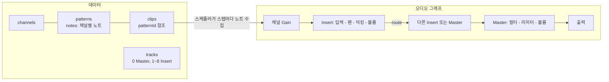

# 학습 도구 "패턴 작곡 실습실" 설계 문서

> 위치: [web/index.html](web/index.html) (파일 하나, 설치 없이 브라우저로 열면 실행)
> 목적: FL Studio의 핵심 시스템을 직접 다뤄 보며 작곡 파이프라인 전체를 한 번 경험하게 한다.
> 관련 문서: [주요 시스템 분석](FL_Studio_주요시스템분석.md) · [작곡 파이프라인별 기능 활용 분석](FL_Studio_작곡파이프라인_활용분석.md) · [문서 색인](README.md)

---

## 1. 설계 원칙

| 원칙 | 내용 |
|---|---|
| 구조는 FL Studio와 같게 | 채널, 패턴, 클립, 믹서 트랙의 관계를 그대로 옮긴다. 화면 모양은 따라 하지 않는다 |
| 부가 기능은 뺀다 | 파이프라인 경험에 꼭 필요하지 않은 기능은 넣지 않는다 (3장) |
| 원리를 눈에 보이게 | 패턴 공유 수, 신호 경로, 패턴 길이 밖 영역처럼 FL에서는 숨어 있는 관계를 화면에 드러낸다 |
| 단계별 안내 | 왼쪽 가이드가 파이프라인 9단계를 안내하고, 조건을 채우면 자동으로 완료 표시 |

## 2. 기능과 FL Studio 시스템의 대응

| 도구의 기능 | 대응하는 FL 시스템 | 학습 포인트 | 시스템 분석 |
|---|---|---|---|
| 채널 랙 (7채널: Kick, Snare, Clap, Hat, 808 Bass, Keys, Lead) | Channel Rack | 소리와 노트의 분리, 채널마다 믹서 트랙 지정 | 2.3, 4장 |
| 스텝 버튼 | Step Sequencer | 스텝 하나 = 피아노 롤 노트 하나 | 4.4 |
| 악기 채널의 미리보기 막대 | Channel Rack 노트 미리보기 | 같은 데이터, 다른 화면 | 4.5 |
| 피아노 롤 (스냅, 스케일 강조, 코드 스탬프, 고스트 노트, 세기) | Piano Roll | (패턴, 채널) 쌍의 노트 편집 | 5장 |
| 피아노 롤 편집 조작: 영역 선택(Ctrl+드래그), 선택 추가(Shift+클릭), 그룹 이동과 길이 조절, 오른쪽 드래그 삭제, 방향키 이동, 복사·잘라내기·붙여넣기, 복제(Ctrl+B), 퀀타이즈(Q), 가로 확대(Ctrl+휠) | Piano Roll 편집 도구 | 노트 목록을 바꾸는 함수로서의 편집 도구 | 5.3 |
| 되돌리기 / 다시 실행 (Ctrl+Z / Ctrl+Y) | Undo History | 곡 데이터 스냅숏 100단계 | - |
| 눈금자 클릭으로 재생 위치 이동 (플레이리스트: SONG, 피아노 롤: PAT), Home 키 | Song position / 타임라인 눈금자 | 곡이나 패턴의 원하는 지점부터 바로 듣기 | 3장 |
| 예제 불러오기, `?demo` 보기 모드 | (학습 보조) | 완성된 편곡 상태를 먼저 보고 구조 이해 | - |
| 패턴 선택, 새 패턴, 복제, 채널별 분할, 삭제 | Pattern 시스템 | 현재 패턴 맥락, Split by channel | 6장 |
| "플레이리스트 N곳에서 사용 중" 표시 | (FL에는 없음, 개선 제안 반영) | 패턴 참조 관계를 눈으로 확인 | 6.12 |
| 패턴 길이 자동 결정 (+1마디 / -1마디) | 패턴 자동 길이 | 마지막 노트 기준 마디 올림 | 6.4 |
| PAT / SONG 모드 | 같은 이름의 모드 | 루프 만들기와 곡 만들기의 오가기 | 6.9 |
| 플레이리스트 클립 (배치, 이동, 길이, 반복, 삭제) | Playlist, Pattern Clip | 클립은 패턴을 가리키는 참조, 종류 없는 트랙 | 6.5, 7장 |
| 클립 위 "공유 N" 표시와 반복 경계선 | (보조 표시) | 참조와 반복을 눈으로 확인 | 6.5 |
| 선택 클립 Make Unique | Make Unique | 한 곳만 바꾸는 방법 | 6.5 |
| 마스터 필터 자동화 레인 | Automation Clip | 시간에 따른 파라미터 변화 (대상 하나로 단순화) | 9장 |
| 믹서 8트랙 + Master (볼륨, 팬, 뮤트, 출력 대상, 사이드체인) | Mixer | 모든 트랙이 같은 종류, 출력만 바꾸면 버스 | 8장 |
| 신호 경로 표시 | (FL에는 없음, 개선 제안 반영) | 채널에서 Master까지의 경로 확인 | 17.3 |
| 스윙 | Channel Rack Swing | 짝수 16분 스텝 지연 | 3.2 |
| WAV 내보내기 | Render | 실시간과 같은 그래프를 오프라인으로 처리 | 11.2 |
| 프로젝트 저장/열기 (.json), 새 프로젝트, 끌어다 놓아 열기, 저장 상태 배지 | Project (.flp) 저장과 열기 | 작업을 파일로 유지하고 이어서 작업 | 12장 |
| MIDI 내보내기 (곡 / 현재 패턴) | MIDI export | 실제 FL Studio로 노트를 옮겨 이어서 작업 | 13.3 |
| 튜토리얼 가이드 열고 닫기 | (학습 보조) | 익숙해지면 가이드를 닫고 넓은 화면으로 작업 | - |

## 3. 일부러 뺀 기능

| 뺀 기능 | 이유 |
|---|---|
| 샘플 불러오기, 브라우저 | 사운드 선택은 고정 7채널로 대신한다. 파일 관리가 학습 흐름을 끊는다 |
| 외부 플러그인, 이펙트 슬롯 | 믹서 학습의 핵심은 라우팅이다. 이펙트 체인은 마스터 리미터로 고정 |
| 오디오 녹음, 오디오 클립 | 브라우저 마이크 권한과 지연 문제가 커서 학습 범위에서 제외 |
| Slide, Mod X/Y 등 FL 전용 노트 속성 | 기본 속성(위치, 길이, 음높이, 세기)만으로 파이프라인 경험이 가능 |
| 오토메이션 대상 선택 | 대상을 마스터 필터 하나로 고정해 "빌드업" 경험에 집중 |
| 패턴 이벤트, Link to controller | 오토메이션 세 갈래 중 클립 방식만 남김 |
| Performance Mode, 타임 마커 | 핵심 파이프라인 밖의 기능 |

## 4. 파이프라인 가이드 9단계

| 단계 | 화면 | 완료 조건 |
|---|---|---|
| 1 사운드 고르기 | 채널 랙 | 채널 3개 이상 미리듣기 |
| 2 리듬 만들기 | 채널 랙 | Kick 4개 이상, Snare와 Clap 합해 2개 이상 |
| 3 코드 진행 | 피아노 롤 (Keys) | 3음 이상이 동시에 울리는 자리 2곳 이상 |
| 4 베이스 | 피아노 롤 (808 Bass) | 베이스 노트 4개 이상 |
| 5 멜로디 | 피아노 롤 (Lead) | 리드 노트 6개 이상 |
| 6 편곡 | 플레이리스트 | 클립 4개 이상, 패턴 2종 이상, 곡 길이 8마디 이상 |
| 7 자동화 | 플레이리스트 | 자동화 사용, 값이 내려간 지점 하나 이상 |
| 8 믹싱 | 믹서 | 출력을 다른 트랙으로 바꾸거나 사이드체인 지정 |
| 9 내보내기 | 상단 버튼 | WAV 저장 |

각 단계에는 "목표 / 해볼 것 / 원리" 세 가지가 있고, 원리 칸은 시스템 분석의 해당 절을 가리킨다.

## 5. 내부 구조

- **데이터 모델:** 시스템 분석 6.3절의 추정 구조를 그대로 썼다. 노트는 `patterns[i].notes[채널 id]`에 있고, 클립은 `patternId`만 가진다.
- **재생:** 25ms마다 앞으로 0.12초 안에 올 스텝을 미리 예약하는 방식. SONG 모드에서는 각 클립의 시작 위치와 패턴 길이로 나머지 연산을 해 반복 재생한다 (시스템 분석 6.7절의 추정 처리와 같음).
- **사이드체인:** 소스로 지정한 Insert에 연결된 채널이 노트를 칠 때, 대상 트랙의 덕킹 게인을 잠깐 낮춘다.
- **내보내기:** 같은 그래프를 OfflineAudioContext에 만들어 곡 전체를 한 번에 예약한 뒤 렌더한다.
- **악기:** 샘플 대신 Web Audio 합성으로 만든 간단한 소리다.
- **저장:** 브라우저 저장소(localStorage)에 자동 저장한다. 같은 브라우저에서 다시 열면 이어서 작업할 수 있다.

## 6. 검증 결과

| 항목 | 결과 |
|---|---|
| 스크립트 오류 | 없음 (콘솔 오류 0) |
| 파이프라인 시나리오 (리듬, 코드, 베이스, 멜로디 입력 -> 채널별 분할 -> 클립 배치 -> Make Unique -> 자동화 -> 사이드체인 -> 내보내기) | 9단계 모두 완료 판정 |
| 내보내기 결과 | 8마디 곡이 18초 길이(꼬리 2초 포함)로 렌더, 최대 진폭 0.76으로 소리가 실제로 담김 |
| 피아노 롤 마우스 조작 (추가, 이동, 삭제) | 정상 |
| 피아노 롤 편집 조작 (영역 선택, 그룹 이동, 방향키, 복사·붙여넣기, 복제, Delete, 오른쪽 드래그 삭제, 그룹 길이 조절, 퀀타이즈, Shift+클릭, Esc, 전체 선택) | 자동 테스트로 모두 정상 |
| 되돌리기 / 다시 실행 | 여러 단계 되돌린 뒤 원래 노트 수(15개)로 복원 확인 |
| 재생 위치 이동 | 눈금자 클릭으로 시작 위치 지정, 그 위치부터 재생 시작, 재생 중 이동, Home 키 모두 정상 |
| 프로젝트 저장/열기 | 예제를 저장한 뒤 새 프로젝트로 비우고 다시 열었을 때 곡 데이터가 저장 전과 완전히 같음. 열기 후 되돌리기로 이전 상태 복귀 |
| 잘못된 파일 | JSON이 아닌 파일, 다른 형식의 파일, 알 수 없는 악기가 든 파일은 거부. 범위 밖 값(BPM 999, 음높이 200 등)과 없는 패턴을 가리키는 클립은 보정하거나 빼고 엶 |
| MIDI 내보내기 | 예제 곡: 헤더 MThd, 트랙 7개(템포 트랙 + 채널 6개), 노트 268개. 현재 패턴: 노트 12개. FL Studio에서 직접 열어 보는 확인은 하지 않음 |
| 가이드 열고 닫기 | 닫기 버튼과 상단 가이드 버튼 모두 정상, 상태 기억 |
| 화면 모양 | 헤드리스 Chrome으로 네 화면(채널 랙, 피아노 롤, 플레이리스트, 믹서)을 캡처해 확인 (README 이미지) |
| 실시간 재생 | 오디오 엔진 동작 확인 |
| 재생 위치 표시 | 직접 확인 필요 (테스트 환경에서 화면 갱신이 멈춰 확인하지 못함) |
| 소리의 품질 | 직접 들어 보지 않음 |

## 7. 실행 방법
- `web/index.html`을 Chrome이나 Edge로 연다. 서버가 필요 없다.
- 브라우저 정책상 첫 소리는 사용자가 무언가를 클릭한 뒤에 난다.
- 단축키: Space 재생/정지.
