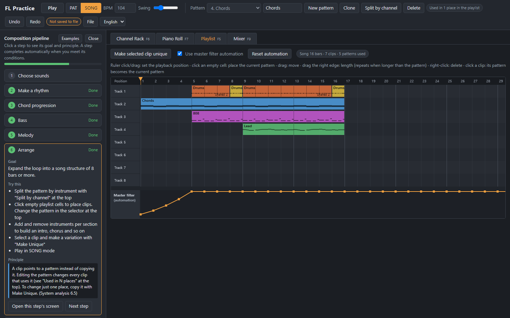
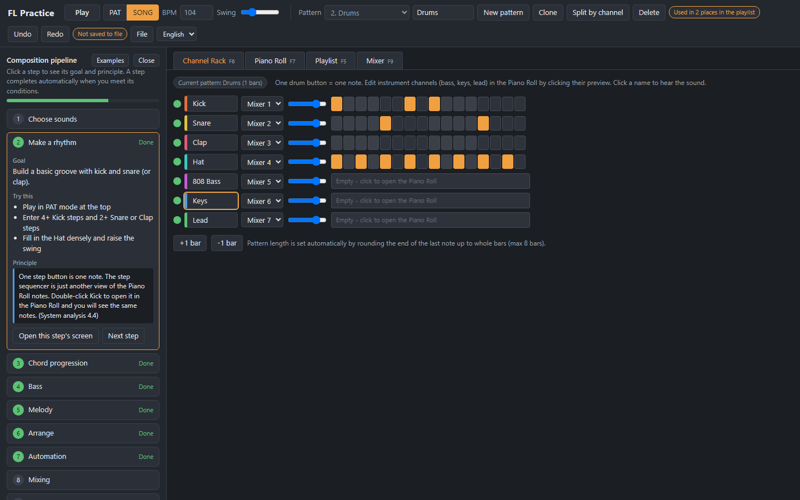
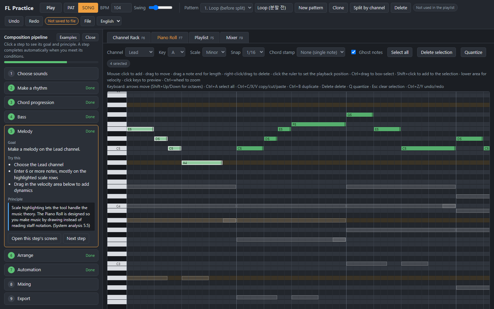
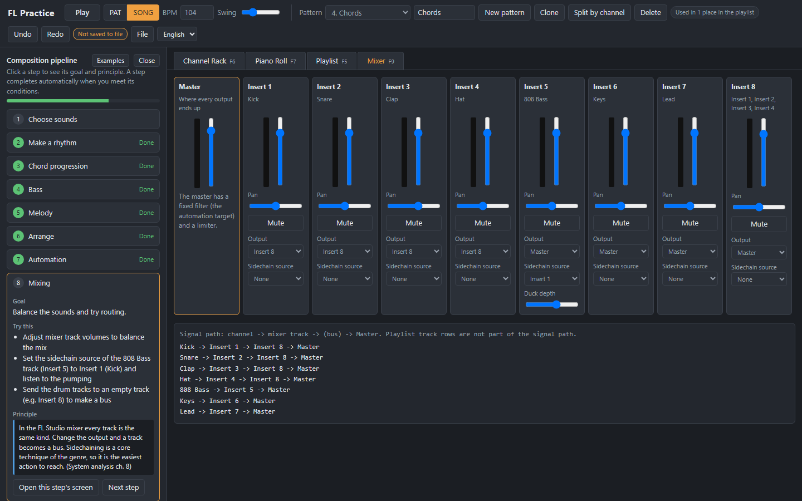
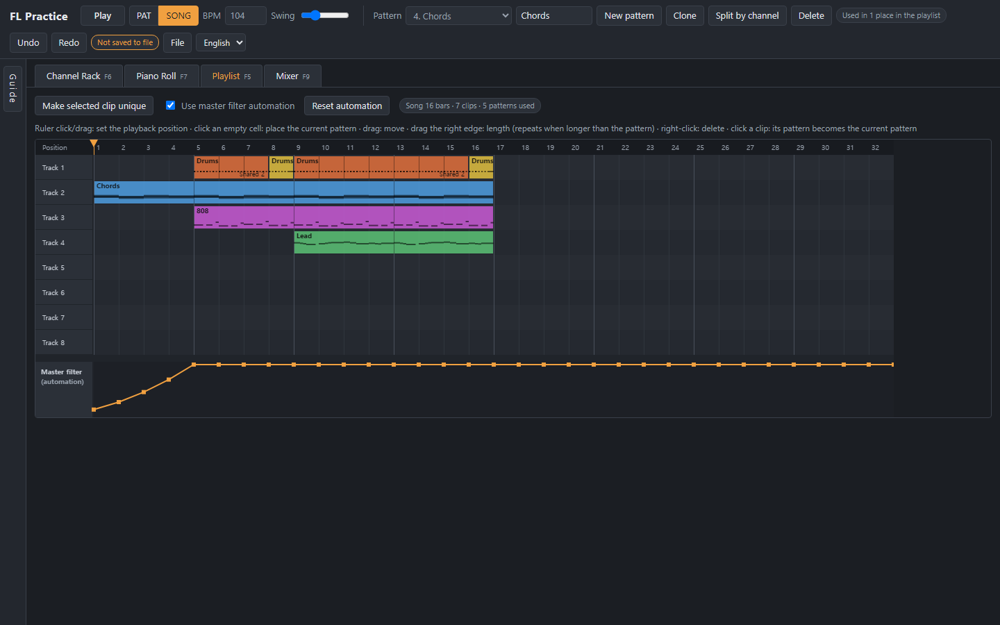
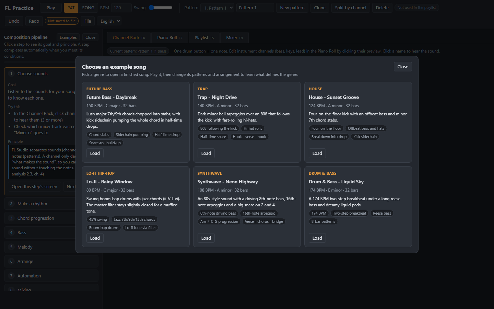

# FL Studio Learning Project

English | [한국어](README.md)

**A project for learning FL Studio.** It analyzes the main systems of FL Studio, picks the features that matter most for writing a song, simplifies them, and turns them into an **interactive tutorial** you can use in the browser.

- **Open a finished example:** https://devleu0.github.io/fl-learn/web/?demo (view mode, nothing is saved)
- **Languages:** English / 한국어 (switch in the header; the first language follows your browser)



## Purpose and method

| | |
|---|---|
| Purpose | Understand how FL Studio works and go through a whole composition once |
| Method 1. System analysis | Start from the visible features and trace back the internal structure and design intent (a reverse-planning approach). Reverse planning is the analysis method, not the goal |
| Method 2. Simplification | Keep only the features the composition pipeline needs (Channel Rack, Piano Roll, patterns, Playlist, Mixer) and leave out the rest |
| Result | A browser tutorial with step-by-step guidance, plus analysis documents (in Korean) |

This tutorial does not replace FL Studio. The goal is to learn the core concepts first, so that you already understand the structure when you move to the real FL Studio.

---

## The FL Practice tutorial

A mini DAW that simplifies the structure of FL Studio (Channel Rack, patterns, Piano Roll, Playlist, Mixer). It does not copy FL Studio's look; it reproduces its **data structure and behavior**. Extra features are left out so you can go from rhythm to export in one sitting.

### Composition pipeline guide
The guide on the left walks you through 9 steps. Each step shows a **goal, things to try and the underlying principle**, and is marked done automatically when you meet its conditions.

| Step | Screen | What you do |
|---|---|---|
| 1 Choose sounds | Channel Rack | Listen to channels, check mixer links |
| 2 Make a rhythm | Channel Rack | Enter kick, snare and hats in the step sequencer, add swing |
| 3 Chord progression | Piano Roll | Scale highlighting, chord stamp |
| 4 Bass | Piano Roll | Line up with the kick and chords using ghost notes |
| 5 Melody | Piano Roll | Melody on the scale, velocity |
| 6 Arrange | Playlist | Split by channel, place clips, Make Unique |
| 7 Automation | Playlist | Master filter build-up curve |
| 8 Mixing | Mixer | Volume, bus routing, sidechain |
| 9 Export | File menu | Save a WAV file |

### Screens

**Channel Rack and step sequencer** - one step button is one note. Each channel picks the mixer track it plays through. The badge at the top shows how many places in the playlist use this pattern.



**Piano Roll** - scale highlighting, chord stamp, ghost notes (other channels in the same pattern), velocity, box selection and keyboard editing.



**Mixer** - every track is the same kind; change a track's output and it becomes a bus. The signal path from each channel to the Master is listed below.



### Features and the FL Studio systems they teach

| Feature | FL Studio system | What you learn |
|---|---|---|
| 7-channel Channel Rack | Channel Rack | Sounds (channels) are separate from notes (patterns) |
| Step buttons | Step Sequencer | Steps are just another view of Piano Roll notes |
| Piano Roll | Piano Roll | Notes belong to a (pattern, channel) pair |
| Pattern select, clone, split by channel | Pattern, Split by channel | The current pattern decides what every window edits |
| PAT / SONG mode | Same modes | Switching between making a loop and making a song |
| Playlist clips | Pattern Clip | A clip points to a pattern instead of copying it |
| Make Unique | Make Unique | How to change just one place |
| "Used in N places", "Shared N" on clips | (not in FL) | See pattern references at a glance |
| Master filter automation | Automation Clip | Parameters changing over time |
| Mixer routing, sidechain | Mixer | Every track is the same kind |
| Signal path list | (not in FL) | The path from a channel to the Master |
| WAV export | Render | The same processing, run offline |

### Shortcuts

| Area | Action |
|---|---|
| Global | F5 Playlist · F6 Channel Rack · F7 Piano Roll · F9 Mixer (same keys as FL Studio) · Space play/stop · Home back to start · Ctrl+Z undo · Ctrl+Y or Ctrl+Shift+Z redo · Ctrl+S save project · Ctrl+O open project |
| Playback position | Click/drag the Playlist ruler: jump to that point in the song (SONG mode) · click the ruler above the Piano Roll: jump to that point in the pattern (PAT mode) · works while playing |
| Piano Roll mouse | Click to add · drag to move · drag a note end for length · right-click/drag to delete · Ctrl+drag box select · Shift+click add to selection · drag in the lower area for velocity · Ctrl+wheel zoom |
| Piano Roll keyboard | Arrows move (Shift+Up/Down for octaves) · Ctrl+A select all · Ctrl+C/X/V copy/cut/paste · Ctrl+B duplicate · Delete · Q quantize · Esc clear selection |
| Playlist | Click an empty cell to place · drag to move · drag the clip end for length (repeats when longer than the pattern) · right-click to delete · clicking a clip makes its pattern the current pattern |

### Saving and exporting
Use the **File** menu in the header to keep your work in files and continue later.

| Feature | Description |
|---|---|
| Save project (Ctrl+S) | Saves the whole song (channels, patterns, clips, mixer, automation, tempo, key) as `project-name.json` |
| Open project (Ctrl+O) | Opens a saved `.json`; you can also drop the file onto the window. Damaged values are corrected into range and files of other formats are rejected |
| New project / load example | Asks first if you have changes not saved to a file. Undo (Ctrl+Z) brings back the previous work |
| Save status | A badge shows "Saved to file" or "Not saved to file" |
| WAV export | Renders the whole song to an audio file |
| MIDI export (song / current pattern) | A standard MIDI file with one track per channel. **Drag it into FL Studio** to continue with the notes you made here. Drums go on channel 10 with GM drum numbers (kick 36, snare 38, clap 39, hat 42). Swing, mixer and automation are not included |

Your work is also auto-saved in the browser, but save a project file if you clear browser data or want to continue on another device.

### Layout
- **Show/hide the guide:** click "Close" at the top of the guide; a "Guide" button stays at the top left in its place to open it again. Hiding it gives the work area more room.
- **Resize the guide:** drag the border between the guide and the work area (220-560px). Double-click it to reset.
- **Piano Roll:** when you change channel or pattern, it scrolls to where the notes are.
- Guide visibility, width and language are remembered in the browser.



### Example songs by genre

There is one finished song for each major genre. Pick one from **"File > Choose an example song"** or the **"Examples"** button at the top of the guide and it opens right away. Play it, then change its patterns and arrangement to learn what defines the genre.



| Genre | Song (opens in view mode) | BPM | Key | Traits | Project file |
|---|---|---|---|---|---|
| Future Bass | [Future Bass - Daybreak](https://devleu0.github.io/fl-learn/web/?demo=future-bass) | 150 | C major | Chord stabs, Sidechain pumping, Half-time drop, Snare-roll build-up | [future-bass.json](examples/future-bass.json) |
| Trap | [Trap - Night Drive](https://devleu0.github.io/fl-learn/web/?demo=trap) | 140 | A minor | 808 following the kick, Hi-hat rolls, Half-time snare, Hook - verse - hook | [trap.json](examples/trap.json) |
| House | [House - Sunset Groove](https://devleu0.github.io/fl-learn/web/?demo=house) | 124 | A minor | Four-on-the-floor, Offbeat bass and hats, Breakdown into drop, Kick sidechain | [house.json](examples/house.json) |
| Lo-fi Hip-hop | [Lo-fi - Rainy Window](https://devleu0.github.io/fl-learn/web/?demo=lofi) | 80 | C major | 45% swing, Jazz 7th/9th/13th chords, Boom-bap drums, Lo-fi tone via filter | [lofi.json](examples/lofi.json) |
| Synthwave | [Synthwave - Neon Highway](https://devleu0.github.io/fl-learn/web/?demo=synthwave) | 108 | A minor | 8th-note driving bass, 16th-note arpeggio, Am-F-C-G progression, Verse - chorus - bridge | [synthwave.json](examples/synthwave.json) |
| Drum & Bass | [Drum & Bass - Liquid Sky](https://devleu0.github.io/fl-learn/web/?demo=dnb) | 174 | E minor | 174 BPM, Two-step breakbeat, Reese bass, 8-bar patterns | [dnb.json](examples/dnb.json) |

- Every song is 32 bars and follows the typical structure of its genre, from intro to drop (or chorus).
- The `?demo=genre` links open a view mode that does not save. To keep working, load the song with "Choose an example song" inside the app.
- All examples are generated by [examples/build_examples.py](examples/build_examples.py). To change a song or add a genre, add a function to `SONGS` and run `python examples/build_examples.py`; it updates `examples/*.json`, `examples/index.json` and `web/examples.js` together.

### Features left out on purpose
Sample loading, external plugins and effect slots, audio recording, FL-only note properties such as Slide, choosing automation targets, Performance Mode and so on. Anything the pipeline does not need was left out.

### Running it
- Use the link above, or download the repository and open `web/index.html` in Chrome or Edge. No server or install is needed.
- Your work is auto-saved in the browser. Use "File > Save project" to keep a file and "File > New project" to start over.
- Browsers only allow sound after you click the page once.

---

## Analysis documents (Korean)

| Document | Contents |
|---|---|
| [FL_Studio_주요시스템분석.md](FL_Studio_주요시스템분석.md) | Main system analysis: timing, Channel Rack, Piano Roll, patterns (in depth), Playlist, Mixer, automation, plugins, audio engine, .flp files, score and data sharing, UX, business model, comparison with other DAWs, improvement ideas, with design intent for each system |
| [FL_Studio_작곡파이프라인_활용분석.md](FL_Studio_작곡파이프라인_활용분석.md) | The features used in each of 13 composition stages, how to use them, the system principles and common mistakes; pipelines by genre and where an LLM can help |
| [FL_Studio_스크립팅_LLM연동.md](FL_Studio_스크립팅_LLM연동.md) | The Score file (.fsc) format, what the two Python scripting APIs can control, and how an LLM could write notes |
| [FL_Studio_학습도구_설계.md](FL_Studio_학습도구_설계.md) | Design of this tutorial: mapping to FL systems, what was left out and why, internals, test results |

## Repository layout
```
.
├── README.md                       # Korean
├── README.en.md                    # English
├── LICENSE                         # MIT
├── index.html                      # start page that redirects to web/
├── web/index.html                  # the tutorial
├── web/examples.js                 # example list read by the app (generated)
├── docs/images/                    # screenshots
├── examples/                       # example songs by genre (project JSON, list, generator)
└── FL_Studio_*.md                  # analysis documents (Korean)
```

## License
[MIT License](LICENSE)

## Limitations
- The analysis is based on public information and behavior visible to users; it may differ from Image-Line's actual implementation.
- The instruments in the tutorial are simple synthesized sounds, not samples.
- FL Studio is a product of Image-Line. This repository is an unofficial project for learning FL Studio and is not affiliated with Image-Line.
