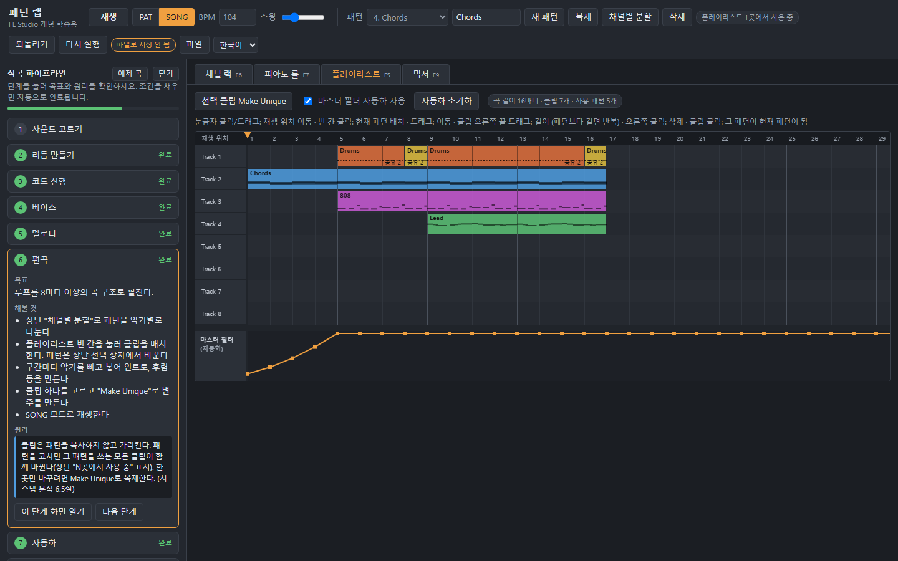
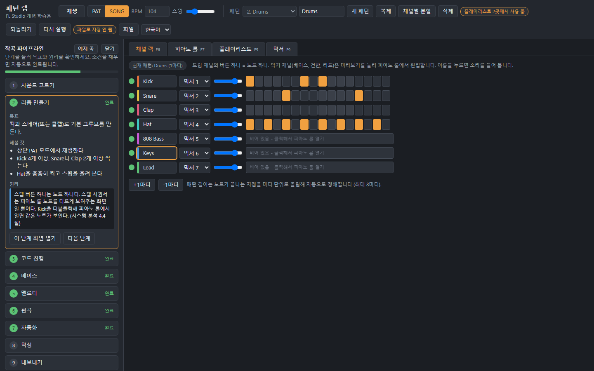
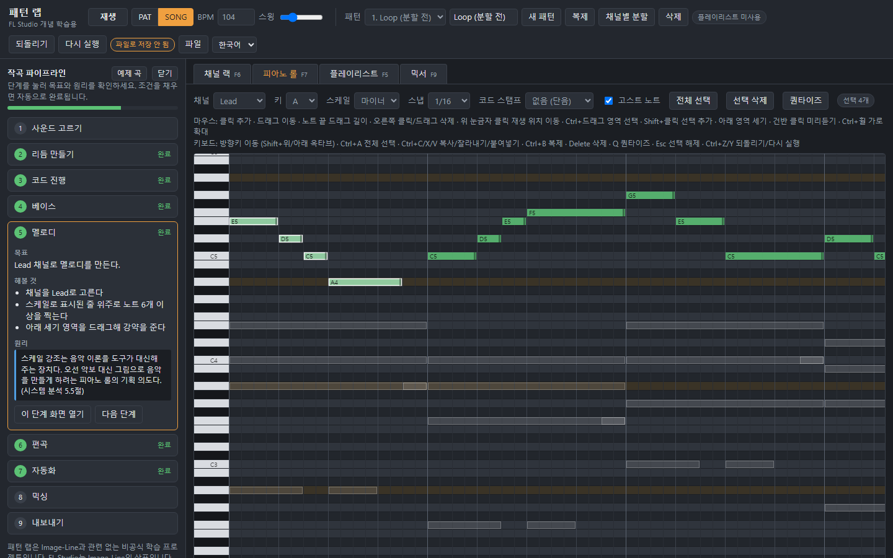
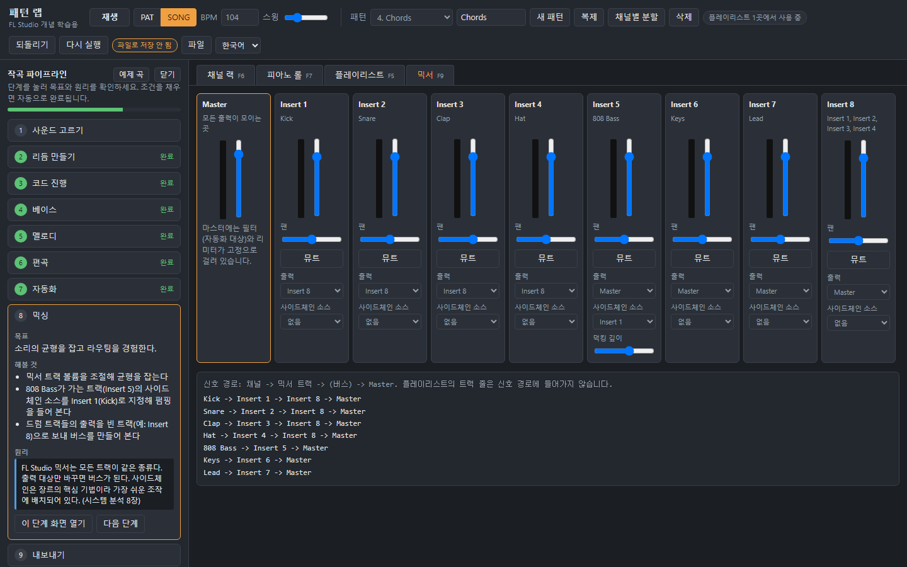
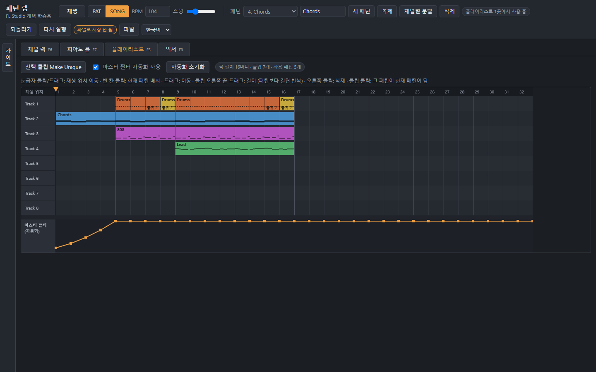
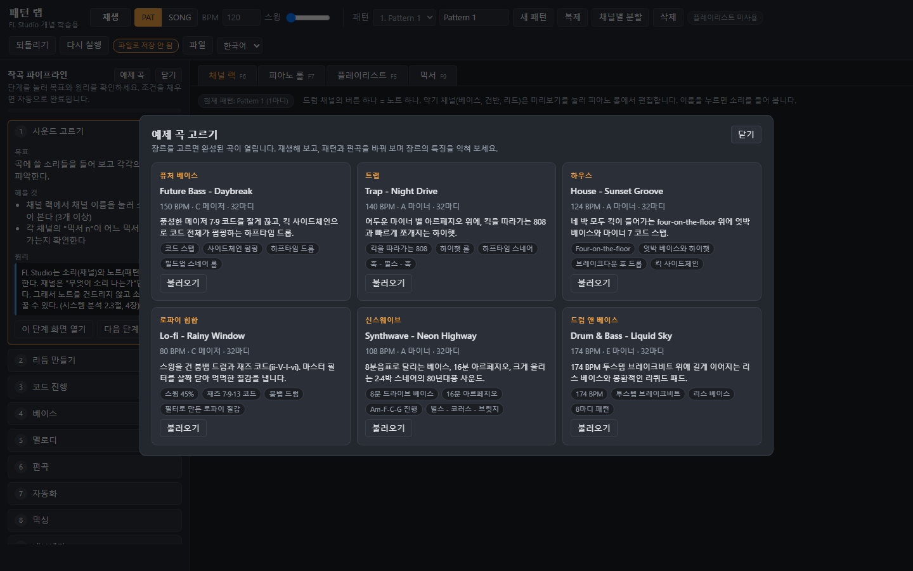

# FL Studio 학습 프로젝트

[English](README.en.md) | 한국어

**FL Studio를 배우기 위한 프로젝트입니다.** FL Studio의 주요 시스템을 분석하고, 그중 작곡에 꼭 필요한 기능만 골라 단순화한 뒤 브라우저에서 직접 해 볼 수 있는 **인터랙티브 튜토리얼**로 만들었습니다.

- **완성된 예제로 열기:** https://devleu0.github.io/fl-learn/web/?demo (저장되지 않는 보기 모드)
- **화면 언어:** 한국어 / English (상단 언어 선택, 브라우저 언어에 따라 처음 언어가 정해짐)



## 프로젝트 목적과 방법

| 구분 | 내용 |
|---|---|
| 목적 | FL Studio의 작동 원리를 이해하고, 작곡 과정 전체를 한 번 경험한다 |
| 방법 1. 주요 시스템 분석 | 사용자에게 보이는 기능에서 출발해 내부 구조와 기획 의도를 거꾸로 추적했다 (역기획 방식). 역기획은 학습을 위한 분석 방법이다 |
| 방법 2. 단순화 | 분석한 시스템 중 작곡 파이프라인에 꼭 필요한 기능(채널 랙, 피아노 롤, 패턴, 플레이리스트, 믹서)만 남기고 나머지는 뺐다 |
| 결과물 | 단계별 안내가 붙은 브라우저 튜토리얼과 분석 문서 |

이 튜토리얼은 FL Studio를 대신하는 프로그램이 아닙니다. FL Studio의 핵심 개념을 먼저 익히고, 실제 FL Studio로 넘어갈 때 구조를 이해한 상태로 시작하도록 돕는 것이 목표입니다.

---

## 패턴 랩 튜토리얼

FL Studio의 구조(채널 랙, 패턴, 피아노 롤, 플레이리스트, 믹서)를 단순화한 미니 DAW입니다. 화면 모양을 따라 하지 않고 **데이터 구조와 동작 원리**를 그대로 옮겼습니다. 부가 기능은 빼고, 리듬부터 내보내기까지 작곡 파이프라인을 한 번에 경험할 수 있게 만들었습니다.

### 작곡 파이프라인 가이드
왼쪽 가이드가 9단계를 안내합니다. 단계마다 **목표, 해볼 것, 원리**가 나오고, 조건을 채우면 자동으로 완료 표시가 됩니다. 원리 칸은 시스템 분석의 해당 절을 가리킵니다.

| 단계 | 화면 | 해보는 것 |
|---|---|---|
| 1 사운드 고르기 | 채널 랙 | 채널 소리 듣기, 믹서 연결 확인 |
| 2 리듬 만들기 | 채널 랙 | 스텝 시퀀서로 킥, 스네어, 햇 찍기, 스윙 |
| 3 코드 진행 | 피아노 롤 | 스케일 강조, 코드 스탬프 |
| 4 베이스 | 피아노 롤 | 고스트 노트로 킥과 코드에 맞추기 |
| 5 멜로디 | 피아노 롤 | 스케일 위 멜로디, 세기 조절 |
| 6 편곡 | 플레이리스트 | 채널별 분할, 클립 배치, Make Unique |
| 7 자동화 | 플레이리스트 | 마스터 필터 빌드업 곡선 |
| 8 믹싱 | 믹서 | 볼륨, 버스 라우팅, 사이드체인 |
| 9 내보내기 | 파일 메뉴 | WAV 파일 저장 |

### 화면

**채널 랙과 스텝 시퀀서** - 스텝 버튼 하나가 노트 하나입니다. 채널마다 연결할 믹서 트랙을 고릅니다. 상단 배지는 이 패턴이 플레이리스트 몇 곳에서 쓰이는지 보여줍니다.



**피아노 롤** - 스케일 강조, 코드 스탬프, 고스트 노트(같은 패턴의 다른 채널), 세기 조절, 영역 선택과 키보드 편집을 지원합니다.



**믹서** - 모든 트랙이 같은 종류이고, 출력 대상만 바꾸면 버스가 됩니다. 아래에 채널부터 Master까지의 신호 경로가 표시됩니다.



### 기능과 FL Studio 시스템의 대응

| 도구의 기능 | FL Studio 시스템 | 학습 포인트 |
|---|---|---|
| 채널 랙 7채널 | Channel Rack | 소리(채널)와 노트(패턴)의 분리 |
| 스텝 버튼 | Step Sequencer | 스텝 = 피아노 롤 노트를 보여주는 다른 화면 |
| 피아노 롤 | Piano Roll | 노트는 (패턴, 채널) 쌍에 속함 |
| 패턴 선택, 복제, 채널별 분할 | Pattern, Split by channel | 현재 패턴이 모든 창의 편집 대상을 정함 |
| PAT / SONG 모드 | 같은 이름의 모드 | 루프 만들기와 곡 만들기 사이 오가기 |
| 플레이리스트 클립 | Pattern Clip | 클립은 패턴을 복사하지 않고 가리킴 |
| Make Unique | Make Unique | 한 곳만 바꾸는 방법 |
| "N곳에서 사용 중", 클립의 "공유 N" | (FL에는 없음) | 패턴 참조 관계를 눈으로 확인 |
| 마스터 필터 자동화 | Automation Clip | 시간에 따른 파라미터 변화 |
| 믹서 라우팅, 사이드체인 | Mixer | 모든 트랙이 같은 종류 |
| 신호 경로 표시 | (FL에는 없음) | 채널에서 Master까지의 경로 |
| WAV 내보내기 | Render | 같은 처리 과정을 오프라인으로 실행 |

### 단축키

| 범위 | 조작 |
|---|---|
| 전체 | F5 플레이리스트 · F6 채널 랙 · F7 피아노 롤 · F9 믹서 (FL Studio와 같은 키) · Space 재생/정지 · Home 재생 위치를 처음으로 · Ctrl+Z 되돌리기 · Ctrl+Y 또는 Ctrl+Shift+Z 다시 실행 · Ctrl+S 프로젝트 저장 · Ctrl+O 프로젝트 열기 |
| 재생 위치 | 플레이리스트 눈금자 클릭/드래그: 곡의 그 지점으로 이동 (SONG 모드) · 피아노 롤 위 눈금자 클릭: 패턴 안의 그 지점으로 이동 (PAT 모드) · 재생 중에도 바로 이동 |
| 피아노 롤 마우스 | 클릭 추가 · 드래그 이동 · 노트 끝 드래그 길이 · 오른쪽 클릭/드래그 삭제 · Ctrl+드래그 영역 선택 · Shift+클릭 선택 추가 · 아래 영역 드래그 세기 · Ctrl+휠 가로 확대 |
| 피아노 롤 키보드 | 방향키 이동 (Shift+위/아래 옥타브) · Ctrl+A 전체 선택 · Ctrl+C/X/V 복사/잘라내기/붙여넣기 · Ctrl+B 복제 · Delete 삭제 · Q 퀀타이즈 · Esc 선택 해제 |
| 플레이리스트 | 빈 칸 클릭 배치 · 드래그 이동 · 클립 끝 드래그 길이 (패턴보다 길면 반복) · 오른쪽 클릭 삭제 · 클립 클릭 시 그 패턴이 현재 패턴이 됨 |

### 프로젝트 저장과 내보내기
상단 **파일** 메뉴에서 작업을 파일로 남기고 이어서 할 수 있습니다.

| 기능 | 설명 |
|---|---|
| 프로젝트 저장 (Ctrl+S) | 곡 전체(채널, 패턴, 클립, 믹서, 자동화, 템포, 키)를 `프로젝트이름.json` 파일로 저장 |
| 프로젝트 열기 (Ctrl+O) | 저장한 `.json` 파일을 엽니다. 파일을 창에 끌어다 놓아도 열립니다. 값이 손상된 파일은 범위 안으로 보정해서 열고, 다른 형식의 파일은 거부합니다 |
| 새 프로젝트 / 예제 불러오기 | 파일로 저장하지 않은 변경이 있으면 먼저 확인합니다. 되돌리기(Ctrl+Z)로 이전 작업을 되살릴 수 있습니다 |
| 저장 상태 표시 | 상단 배지가 "파일 저장됨" / "파일로 저장 안 됨"을 보여줍니다 |
| WAV 내보내기 | 곡 전체를 오디오 파일로 렌더 |
| MIDI 내보내기 (곡 / 현재 패턴) | 채널마다 트랙 하나인 표준 MIDI 파일. FL Studio 등 대부분의 DAW에서 열 수 있는 표준 형식이라, 여기서 만든 노트를 실제 DAW로 옮겨 이어서 작업할 수 있습니다 (FL Studio에서 직접 열어 보는 확인은 하지 않았습니다). 드럼은 GM 드럼 번호(킥 36, 스네어 38, 클랩 39, 햇 42)로 10번 채널에 들어갑니다. 스윙, 믹서, 자동화는 MIDI에 담기지 않습니다 |

작업은 브라우저에도 자동 저장되지만, 브라우저 데이터를 지우거나 다른 기기에서 이어서 하려면 프로젝트 파일로 저장해야 합니다.

### 화면 구성 조절
- **가이드 열고 닫기:** 가이드 위쪽의 "닫기"로 닫으면, 그 자리 왼쪽 위에 "가이드" 버튼만 남고 이 버튼으로 다시 엽니다. 닫으면 작업 화면이 넓어집니다.
- **가이드 너비 조절:** 가이드와 작업 화면 사이의 경계선을 끌어 너비를 바꿉니다 (220\~560px). 경계선을 더블클릭하면 기본 너비로 돌아갑니다.
- **피아노 롤:** 채널이나 패턴을 바꾸면 노트가 있는 높이로 자동 스크롤됩니다.
- 열림 상태, 너비, 언어는 브라우저에 기억됩니다.



### 장르별 예제 곡

주요 장르마다 완성된 곡을 하나씩 넣었습니다. **"파일 > 예제 곡 고르기"** 또는 가이드 위쪽 **"예제 곡"** 버튼으로 고르면 바로 열립니다. 재생해 보고, 패턴과 편곡을 바꿔 보며 장르의 특징을 익혀 보세요.



| 장르 | 곡 (누르면 보기 모드로 열림) | BPM | 키 | 특징 | 프로젝트 파일 |
|---|---|---|---|---|---|
| 퓨처 베이스 | [Future Bass - Daybreak](https://devleu0.github.io/fl-learn/web/?demo=future-bass) | 150 | C 메이저 | 코드 스탭, 사이드체인 펌핑, 하프타임 드롭, 빌드업 스네어 롤 | [future-bass.json](examples/future-bass.json) |
| 트랩 | [Trap - Night Drive](https://devleu0.github.io/fl-learn/web/?demo=trap) | 140 | A 마이너 | 킥을 따라가는 808, 하이햇 롤, 하프타임 스네어, 훅 - 벌스 - 훅 | [trap.json](examples/trap.json) |
| 하우스 | [House - Sunset Groove](https://devleu0.github.io/fl-learn/web/?demo=house) | 124 | A 마이너 | Four-on-the-floor, 엇박 베이스와 하이햇, 브레이크다운 후 드롭, 킥 사이드체인 | [house.json](examples/house.json) |
| 로파이 힙합 | [Lo-fi - Rainy Window](https://devleu0.github.io/fl-learn/web/?demo=lofi) | 80 | C 메이저 | 스윙 45%, 재즈 7·9·13 코드, 붐뱁 드럼, 필터로 만든 로파이 질감 | [lofi.json](examples/lofi.json) |
| 신스웨이브 | [Synthwave - Neon Highway](https://devleu0.github.io/fl-learn/web/?demo=synthwave) | 108 | A 마이너 | 8분 드라이브 베이스, 16분 아르페지오, Am-F-C-G 진행, 벌스 - 코러스 - 브릿지 | [synthwave.json](examples/synthwave.json) |
| 드럼 앤 베이스 | [Drum & Bass - Liquid Sky](https://devleu0.github.io/fl-learn/web/?demo=dnb) | 174 | E 마이너 | 174 BPM, 투스텝 브레이크비트, 리스 베이스, 8마디 패턴 | [dnb.json](examples/dnb.json) |

- 각 곡은 32마디이고, 인트로부터 드롭(또는 후렴)까지 장르의 전형적인 구성을 따릅니다.
- 링크의 `?demo=장르` 주소는 저장되지 않는 보기 모드로 엽니다. 이어서 작업하려면 앱 안에서 "예제 곡 고르기"로 불러오세요.
- 모든 예제는 [examples/build_examples.py](examples/build_examples.py)가 만듭니다. 곡을 고치거나 장르를 더하려면 이 파일의 `SONGS`에 함수를 추가하고 `python examples/build_examples.py`를 실행하세요. `examples/*.json`, `examples/index.json`, `web/examples.js`가 함께 갱신됩니다.

### 일부러 뺀 기능
샘플 불러오기, 외부 플러그인과 이펙트 슬롯, 오디오 녹음, Slide 같은 FL 전용 노트 속성, 자동화 대상 선택, Performance Mode 등. 파이프라인 경험에 꼭 필요하지 않은 기능은 넣지 않았습니다. 이유는 [학습 도구 설계 문서](FL_Studio_학습도구_설계.md) 3장에 있습니다.

### 실행
- 위의 링크로 열거나, 저장소를 받아 `web/index.html`을 Chrome이나 Edge로 엽니다. 서버와 설치가 필요 없습니다.
- 작업 내용은 브라우저에 자동 저장됩니다. 파일로 남기려면 "파일 > 프로젝트 저장", 처음부터 하려면 "파일 > 새 프로젝트"를 씁니다.
- 브라우저 정책상 첫 소리는 화면을 한 번 클릭한 뒤에 납니다.

---

## 분석 문서 (주요 시스템 분석)

| 문서 | 내용 |
|---|---|
| [FL_Studio_주요시스템분석.md](FL_Studio_주요시스템분석.md) | 주요 시스템 분석: 시간 체계, 채널 랙, 피아노 롤, 패턴(심화), 플레이리스트, 믹서, 오토메이션, 플러그인, 오디오 엔진, .flp 파일, 악보·데이터 공유, UX, 비즈니스 모델, 경쟁 비교, 개선 제안. 시스템마다 기획 의도 분석 포함 |
| [FL_Studio_작곡파이프라인_활용분석.md](FL_Studio_작곡파이프라인_활용분석.md) | 작곡 과정 13단계마다 쓰는 기능, 활용법, 시스템 원리, 흔한 실수. 장르별 파이프라인과 단계별 LLM 활용 지도 |
| [FL_Studio_스크립팅_LLM연동.md](FL_Studio_스크립팅_LLM연동.md) | Score 파일(.fsc) 형식, 두 가지 Python 스크립팅의 제어 범위, LLM이 악보를 만드는 방법과 연동 구조 |
| [FL_Studio_학습도구_설계.md](FL_Studio_학습도구_설계.md) | 학습 도구의 설계: FL 시스템과의 대응, 뺀 기능과 이유, 내부 구조, 검증 결과 |

### 읽는 순서
1. 주요 시스템 분석 1\~2장: 전체 구조와 상위 기획 원칙(P1\~P7)
2. 주요 시스템 분석 6장: 패턴 시스템 (FL Studio의 중심)
3. 학습 도구로 직접 작곡해 보기
4. 작곡 파이프라인 문서: 각 기능이 실제 작업에서 어떻게 쓰이는지
5. 스크립팅 문서: 자동화와 LLM 활용의 범위

### 문서 표기 규칙
- `[공개 정보]` 공식 문서나 널리 알려진 공개 정보 (작성 시점 기준이며, 공식 문서와 하나하나 대조하지는 않았음)
- `[추정]` 공개 자료와 동작 관찰을 바탕으로 한 추정
- `[미확인]` 기억에 의존한 내용으로, 공식 문서 대조가 필요함
- `P1`\~`P7` 시스템 분석 2.4절의 상위 기획 원칙

## 저장소 구조
```
.
├── README.md                       # 한국어
├── README.en.md                    # English
├── LICENSE                         # MIT
├── index.html                      # web/ 으로 이동하는 시작 페이지
├── web/index.html                  # 학습 도구
├── web/examples.js                 # 앱이 읽는 예제 목록 (생성기가 만듦)
├── docs/images/                    # README 스크린샷
├── examples/                       # 장르별 예제 곡 (프로젝트 JSON, 목록, 생성기)
├── FL_Studio_주요시스템분석.md
├── FL_Studio_작곡파이프라인_활용분석.md
├── FL_Studio_스크립팅_LLM연동.md
└── FL_Studio_학습도구_설계.md
```

## 상표와 비공식 고지
- 이 프로젝트는 FL Studio를 배우기 위한 **비공식 학습 프로젝트**이며, Image-Line과 제휴하거나 승인·후원을 받지 않았습니다.
- FL Studio, FL Cloud, FruityLoops와 FLEX, Sytrus, Harmor, Gross Beat 등 제품과 플러그인 이름은 Image-Line의 상표입니다. 이 저장소에서는 학습 대상을 가리키기 위해서만 이름을 씁니다.
- Image-Line의 로고, 화면, 소리, 데모 곡, 매뉴얼 내용은 들어 있지 않습니다. 튜토리얼의 화면, 악기 소리, 예제 곡은 모두 이 프로젝트에서 새로 만든 것입니다.
- 분석 문서는 공개 자료와 사용자가 볼 수 있는 동작을 바탕으로 한 학습자의 해석입니다. 소프트웨어를 디컴파일하거나 분해해서 얻은 정보는 없으며, Image-Line의 공식 설명이 아닙니다. 정확한 정보는 Image-Line 공식 문서를 확인하세요.
- 내용에 문제가 있다면 저장소 Issue로 알려 주세요. 바로 고치겠습니다.

## 라이선스
[MIT License](LICENSE). 이 라이선스는 이 저장소의 코드와 글에만 적용되며, 위의 상표에는 적용되지 않습니다.

## 한계
- 분석 내용은 공개 자료와 사용자가 볼 수 있는 동작을 바탕으로 한 것으로, Image-Line의 실제 구현과 다를 수 있습니다.
- 학습 도구의 악기는 샘플이 아닌 간단한 합성음입니다.
